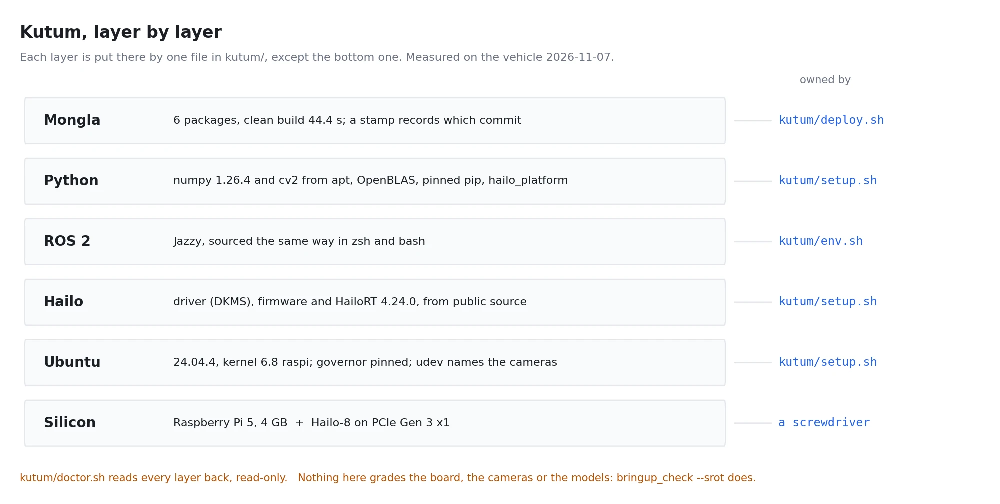

# Kutum — the compute module

> **What this is:** the vehicle's computer, written down. A Raspberry Pi 5 with a Hailo-8
> AI HAT+, running Ubuntu 24.04 and ROS 2 Jazzy, and everything that makes that machine
> *this* machine — kept in the repo under [`kutum/`](../../../kutum/README.md), so it can
> be checked, rebuilt and argued about like any other code.
>
> **State:** setup (user half), deploy, doctor and backup **RUN TODAY** on the vehicle
> (2026-11-07). The machine half of setup and the full rebuild from a blank card are
> **BUILT, NEVER RUN** as one script: every step in them was done by hand on this
> vehicle, but not yet in that order from nothing.



## The name

Abanindranath Tagore made little figures out of branches, roots and driftwood that other
people had thrown away, and called the art **Kutum Katam**. He found something worth
keeping in what everyone else stepped over.

A Raspberry Pi is the thing everyone steps over. It is the board in a drawer, the one you
use for a weather station. Put a Hailo-8 on it and it runs two cameras, two detectors and
a 50 Hz control loop with 70 % of its CPU idle ([the measurement](pi-hailo-vision-box.md)). Kutum is that machine,
and it is also the habit of treating it as part of the vehicle rather than a box that
happens to be inside it.

## Why it has a folder now

The computer before this one was a Jetson Orin. It burned at RoboSub 2025, with the whole
vision pipeline on it. The pipeline survived, because it was in git (that stack is at the
tag `last-with-pixhawk-and-sim`). **The machine did not**:
which packages, which pins, which udev rules, which service files, which line in which rc
file — that lived on the dead SD card and in people's heads.

The Pi went the same way for two months. When we finally looked (2026-11-07), it was
working, and nobody could have rebuilt it:

| What we found | Why it mattered | What Kutum does now |
|---|---|---|
| `~/.zshrc` sourced nothing; only `~/.bashrc` sourced ROS | the login shell is **zsh**, so every ssh terminal started without ROS | `kutum/env.sh`, sourced from both rc files, picks the right ROS setup file per shell |
| `hailo-web.service` restarted every 3 s, forever | its program had been deleted, and its *stop* command kills whatever holds `/dev/video0` and `/dev/hailo0` | `setup.sh --system` disables any unit whose program is gone and files it in the attic; the doctor FAILs on one |
| `~/mongla_ws` was a hand-rsynced copy | it still carried a deleted package, old tools and agent tooling; nothing said which commit it was | `deploy.sh` is the only way in: a new release per deploy, built from clean beside the live one, switched atomically, with a manifest naming the commit, models and packages (#64) |
| HailoRT, its driver and its firmware were built by hand | from public source at v4.24.0, but nothing recorded how | `setup.sh --system` step 2, one version pinned in one place |
| The compiled XFeat artifacts existed only on the vehicle | one dead card and they were gone | `backup.sh` pulls them, and everything else made on the vehicle, to the dev box |
| `wpasupplicant` had been removed | Wi-Fi could not join anything | `setup.sh --system` installs it and writes the network you name; `mongla.local` answers on Wi-Fi and Ethernet |
| The RTC battery was fitted but its charging was off | a rechargeable cell runs flat, and then the clock forgets the date at every power-off | `setup.sh --system` turns charging on at 3.0 V; the doctor reads it back |
| Scripts in `~` from the retired workspace, two HailoRT logs, three stale repo clones | each one a wrong answer waiting to be run | moved to `~/attic/2026-11-07/home/`, nothing deleted |

## Five verbs

Everything Kutum does is one of five files. Each one is safe to run again.

| Verb | Where you type it | What it changes |
|---|---|---|
| `sudo kutum/setup.sh --system` | on the vehicle, once per machine | the machine: apt packages, the Hailo driver, firmware and runtime, udev and systemd files, passwordless sudo, then the user half |
| `kutum/setup.sh` | on the vehicle | your account only: pinned Python packages, the HailoRT bindings, the rc-file line. No sudo |
| `kutum/deploy.sh fh1m@mongla.local` | on the dev box, after every change | the workspace: refuse if the stack runs or the board is armed, stage a release, doctor, build, switch, then the vehicle's own gate. `--rollback`, `--list` |
| `kutum/doctor.sh` | either (`ssh fh1m@mongla.local bash -s < kutum/doctor.sh`) | nothing. It reads every layer back and exits 1 on a FAIL |
| `kutum/backup.sh fh1m@mongla.local` | on the dev box | nothing on the vehicle. Pulls what only the vehicle has |

`kutum/env.sh` is the sixth file, and it is not a verb: it is what every terminal on the
vehicle sources. Usage, flags and the rebuild checklist are in
[`kutum/README.md`](../../../kutum/README.md), next to the scripts they describe.

**Key point:** the doctor and `bringup_check` split the work at the USB port. The doctor
grades the machine — the OS, ROS, the Hailo, Python, the system files and what boots. It
never looks at the board, the cameras' images or the models. `ros2 run mongla_manager
bringup_check` grades those, and the doctor will happily say "no FAIL" on a vehicle
whose board is unplugged.

## The machine, as measured

Read by the doctor, `lscpu` and `hailortcli` on 2026-11-07.

| Layer | Value |
|---|---|
| Board | Raspberry Pi 5 Model B Rev 1.0, 4 × Cortex-A76 at 2.8 GHz (stock is 2.4; set by `setup.sh --system`, measured-bars 82), 4 GB |
| Accelerator | Hailo-8 (26 TOPS) on PCIe **Gen 3 x1, 8 GT/s** |
| Storage | 32 GB SD card, 9.9 GB free after the tidy |
| OS | Ubuntu 24.04.4 LTS, kernel 6.8.0-1065-raspi, governor pinned to `performance` |
| ROS | ROS 2 Jazzy (`ros-base`), 225 `ros-jazzy-*` packages |
| Hailo | driver `hailo_pci` 4.24.0 (DKMS), firmware 4.24.0, HailoRT 4.24.0, `hailo_platform` 4.24.0 |
| Python | numpy 1.26.4 and cv2 from apt, OpenBLAS; pip: pymavlink 2.4.49, filterpy 1.4.5, scipy 1.17.1, onnxruntime 1.29.0, supervision 0.26.1, trackers 2.4.0 |
| Clock | Pi 5 RTC on the official battery, charging at 3.0 V; network time when there is a network |
| Network | Ethernet (DHCP, link-local fallback) and Wi-Fi, both as `mongla.local` |
| Health | never throttled since boot, 38–51 °C |
| Build | 6 packages, clean `colcon build` in **44.4 s** |

**Warning:** every one of those Python versions is a pin for a reason. numpy 2 breaks
`cv_bridge`, a pip OpenCV shadows the system one, and `trackers` 2.5.0 on PyPI is an empty
wheel. [The environment traps](pi-and-env-traps.md) has each one, with the symptom you will
actually see.

## The home folder

After the tidy, everything in `~` on the vehicle is one of these. The names the code reads
are marked; moving one of those is a code change.

```
~/mongla_ws/          a symlink to the active release                  (read by env.sh)
~/mongla/releases/    one built tree per deploy; only deploy.sh writes  (kutum/release.sh)
~/mongla/previous     the release --rollback returns to
~/mongla_runs/        one folder per run: bags, logs, scorecards        (MONGLA_RUN_DIR default)
~/hailo_models/       compiled artifacts kept outside the workspace,
                      so a clean build cannot delete them               (MONGLA_HEF_DIR)
~/calib_<camera>[_water]/  calibration captures; the guide resumes here (calibration/guide.py)
~/.mongla/            the deck's own config: bringup.yaml, courses      (created when needed)
~/.hailo/hailort/     HailoRT's log, in one place                       (HAILORT_LOGGER_PATH)
~/hailort_src/        HailoRT v4.24.0, the source the runtime and the
                      Python bindings were built from                   (setup.sh)
~/hailort_drivers/    hailort-drivers v4.24.0: the PCIe driver and the firmware (setup.sh)
~/hailo_dkms/         root-owned build leftovers of the driver; DKMS's real copy
                      is /usr/src/hailo_pci-4.24.0
~/data/               measurements and footage nothing reads by path:
    bench/              IMU Allan runs, mixer and ladder checks
    calibration/        earlier calibration captures
    clips/              the replay clips
    hailo_bench/        the harnesses behind the vision-box numbers
    murky/              the murky-water frames
    duburi_runs/        two telemetry logs from the retired workspace
~/attic/<date>/       anything superseded, moved rather than deleted
```

## When Kutum burns

It will. The last one did. What you lose, and what you do not:

| Lost with the card | Comes back from |
|---|---|
| the OS, ROS, the Hailo stack, every pin, every system file | `sudo kutum/setup.sh --system` |
| the workspace and its build | `kutum/deploy.sh` |
| compiled artifacts in `~/hailo_models`, the deck config, calibration captures | the last `kutum/backup.sh` — **so run it after anything is made on the vehicle** |
| runs and footage in `~/mongla_runs` and `~/data` | `kutum/backup.sh --runs`, if you ran it |
| the hardware | a screwdriver. The HAT's PCIe cable is the part that gets knocked loose |

The steps, in order, are in [`kutum/README.md`](../../../kutum/README.md#when-kutum-burns).

## What Kutum is not

- **Not a configuration manager.** One machine, one owner, Bash that ships with the OS. Ansible
  or Nix would be a second language to keep in your head for a problem that is five files
  long. The day there are three vehicles, that answer changes.
- **Not the vehicle's gate.** The doctor grades the computer; `bringup_check` decides
  whether the vehicle can arm.
- **Not a place for experiments.** Research on the vehicle runs from the deployed tree or in
  `~/data/hailo_bench/`, and what it finds comes back through git like everything else.
  A script that only exists in `~` is how the last two months happened.

## See also

- [The Pi + AI HAT+ vision box](pi-hailo-vision-box.md) — the measurement that chose this machine
- [Environment traps](pi-and-env-traps.md) — the five ways the environment takes the vision launch down
- [Ground-station remote access](remote-access.md) — mosh, tmux, and never needing a desktop
- [The operator runbook](../platform/launch-combinations.md) — what to launch once Kutum is up
