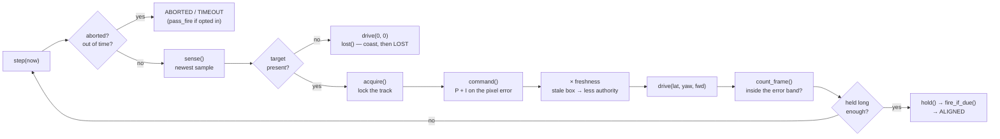

# mongla_control — the verbs, and the line between us and the hardware

**no ROS nodes · [`src/mongla_control`](../../../../src/mongla_control)**

This package answers two questions:

1. **What does "move forward" actually mean?** Every verb's implementation lives here.
2. **How do we talk to the board?** One driver, `SrotFC`, over one USB-C link.

It is a plain Python library: it starts no nodes and subscribes to nothing — `mongla_manager`
imports it. That separation is what lets the tests exercise the real control logic with no ROS
graph and no vehicle.

---

## The board boundary

```
            Mongla facade  (one method per verb)
                   │
                SrotFC   (arm, mode, manual, move, fire, read)
                   │
          MAVLink 2 over USB-C, compid 191
                   │
        SROT board — Hengla firmware, 500 Hz
```

`fc/base.py` defines the typed outcomes every board call returns. `fc/srot_protocol.py` is the
**one copy** of the wire constants shared with the firmware, and a test reads the firmware's
own headers to prove it has not drifted. `fc/port_guard.py` enforces that one process owns the
serial port — a second one gets a clear error instead of a corrupted link. There is one board,
so there is no backend interface and no selector; the earlier stack lives at the tag
`last-with-pixhawk-and-sim`.

## The verbs

Twenty-three of them, in one registry (`commands.py`). Adding one touches two places: a row in
that registry and a method of the same name on the facade. The CLI, the action server and the
Python client pick it up with no further edits.

| Group | Verbs | What happens |
|---|---|---|
| **On the board** | `move_forward` · `move_back` · `move_left` · `move_right` · `yaw_left` · `yaw_right` · `turn` · `set_depth` · `stop` · `pause` · `style_roll` | one `SROT_MOVE`, run and braked on the board at 500 Hz |
| **Here** | `arm` · `disarm` · `set_mode` · `head` · `surface` · `mission_reset` · `calibrate_depth` · `calc_distance` · `fire` · `motor_test` · `vision_align` · `vision_move` | a host loop, or a single message |

A name that is not in the registry fails at the node with `Unknown command` and puts nothing on
the wire. There is no third "refused" group: a verb the board cannot run does not exist.

## The two vision verbs

Only two, and they are pixel-native: no metric model of the world is needed to use them.

- **`vision_align`** — hold the target at a chosen offset on the axes you name (sideways, yaw,
  and a forward standoff or, on the downward camera, surge). It can hold station for a few
  seconds and fire the payload mid-hold, on a *fresh* detection. It never commands depth:
  `set_depth` first, then align.
- **`vision_move`** — drive toward the target until it fills a chosen fraction of the frame,
  or straight through it.

Neither raises. Both return an outcome — aligned, lost, timed out, no camera, aborted,
drifted — plus where the target was when the verb ended, so a mission can recover instead of
guessing. They actuate through `MANUAL_CONTROL` in STABILIZE at 50 Hz.

### One tick of `vision_align`

Both loops are classes in the `motion_vision/` package: `_Align` in `align.py` and `_Move` in
`move.py`, over a shared `_VisionLoop` in `control.py`
that owns the outcome, the frame clock, the lost-target ladder and the promise that every exit
leaves the thrusters neutral. Each tick is a fixed sequence of named stages, so a stage can be
read, and tested, on its own:



`_Move` has the same skeleton with `commit` (a pass-through that has cleared the gate),
`maintain` (lateral centring) and `approach` (drive until the target fills the frame) in place
of the align stages. `run()` wraps the loop in `try/finally: neutral_on_exit()`, so an
exception anywhere in a stage still stops the thrusters.

## The map

| File | Role |
|---|---|
| `commands.py` | the registry: one row per verb, the single source of truth |
| `mongla.py` | the facade: locking, dispatch, and the safety verbs |
| `fc/srot_fc.py` | the board driver `SrotFC`: the link, arming, modes; one class assembled from the `srot_*` parts below |
| `fc/srot_motion.py` | `move()`: one `SROT_MOVE` and its ACK relay; `manual()`, `demand()` |
| `fc/srot_moves.py` | the move envelope, the ACK budget, the `SROT_MOVE` parameter builders |
| `fc/srot_arming.py` | the arming interlocks: firmware revision, thruster power, the depth loop |
| `fc/srot_telemetry.py` · `fc/srot_health.py` | what the board reports: attitude, IMU, batteries; STATUSTEXT, the boot burst, reboots, ESC and leak health |
| `fc/srot_params.py` · `fc/srot_bench.py` · `fc/srot_uplink.py` | parameters and the preflight checks; bench-only motor test / detect / tune; what the host sends the board it sees |
| `fc/srot_payload.py` · `fc/_srot_base.py` | `SrotPayload` (fire(N) on board channel N); the shared names and the one MAVLink 2 import |
| `fc/srot_protocol.py` · `fc/base.py` · `fc/port_guard.py` | wire constants, typed outcomes, one owner per port |
| `motion_vision/` · `motion_writers.py` · `motion_rates.py` | the two vision loops, what they write, and their tick rate |
| `vision_verbs.py` | the verbs on top of those loops: mode gating, firing, evidence |
| `allocation.py` · `actuation_model.py` | what the mixer will *actually* deliver, and what the board does with a demand |
| `geometric_allocation.py` · `hydrodynamics.py` | the hull's real thruster geometry and what its shape implies |
| `bearing.py` · `nav_filter.py` | pixel → bearing, and the small filters the loops share |
| `errors.py` | the typed failures every verb raises |

The heartbeat and the heading source live in `mongla_manager` (`_HeartbeatThread`,
`yaw_source.BoardYaw`), next to the link they serve.

## Why `allocation.py` exists

Ask for full forward *and* full yaw and the mixer cannot give you both. The board scales the
whole set down uniformly, which quietly steals authority from the axis you cared about. So the
host fits the demand first — yaw first, because that is what the tool points with — and sends
something the mixer can honour. Below saturation it changes nothing.

## Testing

```bash
python3 -m pytest -q src/mongla_control/test
```

The style matters more than the count (that lives in [the packages page](../README.md)): the board is faked at the wire, so a test
fails when a *real* defect is injected. Several of these tests exist precisely because an
earlier version of them passed while the vehicle was broken.

---

Related: [`mongla_manager`](../mongla_manager/README.md) (who calls this) ·
[Capability Map](../../capability-map.md) · [The Shift](../../the-shift.md)

## Every module

<!-- modules:begin -->
Generated from each module's docstring by `tools/gen_reference.py`; a module
with no summary line shows as *(no summary)* until it gets one.

| module | what it is |
|---|---|
| `actuation_model.py` | What the board actually does with a demand, and how to undo it. |
| `allocation.py` | What the mixer will actually deliver, computed before we ask for it. |
| `bearing.py` | Pixels to bearings. The conversion that gives our vision gains units. |
| `commands.py` | Single source of truth for every /mongla/move command. |
| `errors.py` | Verb-layer exceptions. |
| `geometric_allocation.py` | Allocate a wrench to thrusters using the hull's real geometry. |
| `hydrodynamics.py` | What the hull's SHAPE implies, before anybody weighs anything. |
| `mongla.py` | one method per verb. |
| `motion_rates.py` | The vision loops' tick rate and log throttle. |
| `motion_writers.py` | What the vision loops write to the board, and how they wait. |
| `nav_filter.py` | Alpha-beta filters for navigation signals. One core, three wrappers. |
| `vision_verbs.py` | Vision verbs for the Mongla facade -- exactly two, pixel-native. |
| `fc/_srot_base.py` | The few names every part of the SROT driver shares. |
| `fc/base.py` | The result types every board call returns, and the vehicle snapshot. |
| `fc/port_guard.py` | One process owns the srot serial port. Everything else is refused, loudly. |
| `fc/srot_arming.py` | The arming interlocks: firmware behaviour revision, thruster power, the depth loop. |
| `fc/srot_bench.py` | Bench verbs: motor test, motor detect, autotune and motor tune. |
| `fc/srot_fc.py` | the host side of the SROT board (firmware Hengla). |
| `fc/srot_health.py` | What the board says about itself: its announcements, reboots, thrusters and leak. |
| `fc/srot_motion.py` | Motion: the SROT_MOVE verbs, their ACK relay, and MANUAL_CONTROL. |
| `fc/srot_moves.py` | What one SROT_MOVE may ask for, and how long to wait for its answer. |
| `fc/srot_params.py` | Board parameters and the preflight checks that read them. |
| `fc/srot_payload.py` | SrotPayload: fire(N) on board channel N, over MAVLink. Split out of srot_fc.py. |
| `fc/srot_protocol.py` | SROT wire protocol -- the SINGLE source of the SROT/Hengla MAVLink constants. |
| `fc/srot_telemetry.py` | Reading the vehicle: attitude, IMU, batteries, and the one telemetry snapshot. |
| `fc/srot_uplink.py` | What the host tells the board it sees: a vision target, a speed, a position. |
| `motion_vision/align.py` | `align_loop`: centre a target on the chosen axes and hold it there. |
| `motion_vision/control.py` | What both vision loops share: outcome codes, tuned constants, pure helpers, |
| `motion_vision/freshness.py` | How much a bounding box may still steer, from how old it is. |
| `motion_vision/move.py` | `move_loop`: drive toward a target until it fills the frame, or through it. |
| `motion_vision/srot_drive.py` | Turning a vision demand into one MANUAL_CONTROL frame the board can act on. |
<!-- modules:end -->
