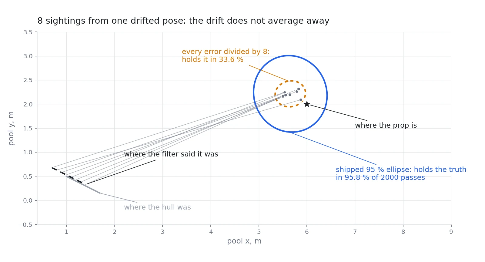

# mongla_localization — where am I, and am I moving?

**[`src/mongla_localization`](../../../../src/mongla_localization)**

Underwater there is no GPS: radio does not travel through water. The usual answer is a
**DVL** — a sonar that measures speed over the seabed. We do not have one fitted.

This package is the answer to that: build a position estimate from the sensors we *do* have —
the board's IMU, its depth reading, the downward camera, and the things we recognise in the
water.

---

## First principles: why an IMU alone is not enough

An accelerometer measures acceleration. Integrate once for velocity, twice for position — and
integrate the error twice as well. A tiny constant bias becomes a drift that grows with the
square of time. Minutes of blind travel are impossible; seconds are realistic.

So the filter is not "integrate the IMU". It is: **predict with the IMU, correct with anything
that measures the world.**

| Correction | Where it comes from | What it pins down |
|---|---|---|
| Depth | the board's pressure sensor | one axis, absolutely |
| Velocity over the floor | the downward camera's optical flow | drift in the other two |
| Zero-velocity updates | knowing we are *not* moving | sensor bias, while stationary |
| Expected motion from the demand | what we just asked the thrusters to do | the gap while vision is blind |
| Heading | a prop of known bearing, pool lane lines, or the floor tile grating | the direction everything else is measured in |
| Position fixes | a recognised prop whose location is known | absolute position, occasionally |

## Two design choices worth explaining

**An invariant filter.** A standard Kalman filter linearises around the current estimate, and
for rotations that makes its error behaviour depend on which way the vehicle happens to be
pointing. The invariant formulation (`inekf.py`) puts the state on the group of rigid motions,
where the error evolves the same way regardless of heading — better behaved, and much harder
to fool with a large initial error.

**Late measurements are replayed, not pretended.** A camera measurement describes the instant
the shutter opened, but arrives tens of milliseconds later, after the filter has moved on.
Applying it to *now* compares the past against the present and calls the difference error.
`retro.py` keeps a short event log, restores the filter to the moment the measurement
describes, applies it there, and replays what followed. The cost scales with how late a
measurement is, not with the length of the log.

## The map

| File | Role |
|---|---|
| `inekf.py` | the filter: a right-invariant EKF over position, velocity and attitude |
| `localization_node.py` | wiring: every sensor in, one odometry estimate out |
| `retro.py` | the event log and replay for late measurements |
| `command_velocity.py` | motion predicted from the demand we sent |
| `floor_plane.py` | range to a point on a known plane — one pixel is enough |
| `tile_grating.py` | the pool floor's tile pattern read as a two-dimensional encoder |
| `pool_lines.py` | heading from lane lines |
| `heading_anchor.py` | absolute heading from a prop of known bearing |
| `resection.py` | position from bearings to two known props |
| `pose_cluster.py` · `pose_fuse_node.py` | many single-frame pose estimates → one |
| `pnp_node.py` | the pose of a prop, from its detected corners |
| `course_map.py` + `courses/*.yaml` | what the venue contains, and where |
| `course_survey.py` | measure the real venue and write it into your own copy |
| `prop_placement.py` | where a prop really is, from several sightings; the hull's error enters once, not divided by the count ([ledger §67](../../measured-bars.md)) |

## Venue priors, without hard-coding a pool

A competition course is known in advance — roughly. `courses/*.yaml` holds each prop's class,
size and position. Nothing is baked into a mission: the loader prefers your own copy
(`~/.mongla/courses`) over the packaged one, so a survey on the day overrides the shipped
guess with no rebuild.

```bash
ros2 run mongla_localization course_survey --course sauvc26 --prop gate --x 3.5 --y 0.0
```

Positions that were never measured are left empty rather than invented, and marked as such.

### Or let the vehicle place them

A tape is not the only way in. `mission survey_course` anchors the heading, turns to each prop
from one station, and calls `place_prop(commit=True)`: several range-and-bearing sightings,
fused by `prop_placement.place`, written into the same deck copy. The one subtlety is the
whole design. Every sighting in a pass is taken from the same pose, so the pose's error is
**common** to all of them and does not shrink with more sightings; only the range and bearing
noise does. Divide both by the count and the ellipse looks tight and is wrong two times in
three:



The same common error is why **spacing** comes out far better than position: two props placed
in one pass share it, and it cancels in their difference (median 0.019 m against 0.356 m,
[ledger §67](../../measured-bars.md)). A `measured: true` prop is only *checked* against the
sightings and never overwritten, so a run from a drifted pose cannot rewrite the survey that
would correct it. Figure: `python3 tools/fig_prop_placement.py`, computed by the shipped code.

## Running it

It starts with the vehicle (`localization:=true`, on by default). Its optional pieces are
separate switches — replay of late measurements, zero-velocity updates, heading fusion, the
tile grating — so each can be enabled alone and measured.

## Testing

```bash
python3 -m pytest -q src/mongla_localization/test
```

Most of the tests are built on truth by construction: generate a trajectory, feed the filter, compare
against the trajectory it came from. The replay test compares a late measurement against the
same measurement applied on time and asserts they land in the same place — with the old
on-arrival behaviour failing that same check.

---

Related: [`mongla_vision`](../mongla_vision/README.md) (where velocity comes from) ·
[Capability Map](../../capability-map.md)

## Every module

<!-- modules:begin -->
Generated from each module's docstring by `tools/gen_reference.py`; a module
with no summary line shows as *(no summary)* until it gets one.

| module | what it is |
|---|---|
| `command_velocity.py` | Velocity from what we COMMANDED, learned while the floor was readable. |
| `course_map.py` | Where the props are, per course. The prior half of perceive-then-move. |
| `course_survey.py` | ``ros2 run mongla_localization course_survey`` -- write MEASURED prop positions. |
| `floor_plane.py` | Range to a point on a KNOWN horizontal plane, from one pixel. No object size. |
| `frames.py` | Frames: the names, the sensor offsets, and the conversions -- one owner. |
| `heading_anchor.py` | Recover an ABSOLUTE heading from a prop whose world bearing is known. |
| `inekf.py` | Right-invariant EKF on SE_2(3): where the hull is, from what it can feel. |
| `launch_defaults.py` | Bringup settings from a file, so a pool day is a file and not a long command. |
| `localization_inputs.py` | What the localization node does with each measurement as it arrives. |
| `localization_node.py` | The vehicle's own answer to "where am I", fused from every sensor it has. |
| `localization_publish.py` | What the localization node publishes: the odometry and its diagnostic line. |
| `orphan.py` | Every long-running node dies with its parent. |
| `params_file.py` | The node half of `~/.mongla/bringup.yaml`: a typo in `nodes:` stops the node. |
| `pnp_node.py` | One PnP solver for every evidence source. Subscribe correspondences, publish a pose. |
| `pool_lines.py` | The lane line is a surveyed straight edge. Read a heading off it. |
| `pose_cluster.py` | Fuse a stream of single-frame poses into one answer, with its support. |
| `pose_fuse_node.py` | Subscribe single-frame poses, publish the one the support agrees on. |
| `prop_placement.py` | Where a prop is, from several sightings of it taken from where we think we are. |
| `resection.py` | Absolute position from bearings to props whose positions we know. |
| `retro.py` | Apply every filter event at the instant it describes, not the instant it arrived. |
| `tile_grating.py` | The pool floor is a surveyed 2-D grating. Read it like an optical encoder. |
<!-- modules:end -->
