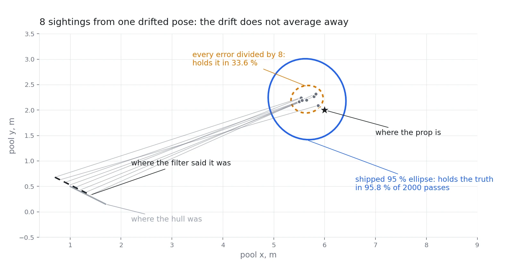

# mongla_localization — where am I, and am I moving?

**[`src/mongla_localization`](../../../../src/mongla_localization)**

Underwater there is no GPS: radio does not travel through water. The usual answer is a
**DVL** — a sonar that measures speed over the seabed. We do not have one fitted.

This package is the answer to that: build a position estimate from the sensors we *do* have —
the board's IMU, its depth reading, the downward camera, and the things we recognise in the
water.

What every file does, what was moved out and why, the defects found and what water has
to decide first: [the audit](audit.md).

---

## First principles: why an IMU alone is not enough

An accelerometer measures acceleration. Integrate once for velocity, twice for position — and
integrate the error twice as well. A tiny constant bias becomes a drift that grows with the
square of time. Minutes of blind travel are impossible; seconds are realistic.

So the filter is not "integrate the IMU". It is: **predict with the IMU, correct with anything
that measures the world.**

| Correction | Where it comes from | What it pins down |
|---|---|---|
| Depth | the board's pressure sensor | one axis, absolutely |
| Velocity over the floor | the downward camera's optical flow | drift in the other two |
| Zero-velocity updates | knowing we are *not* moving | sensor bias, while stationary |
| Expected motion from the demand | what we just asked the thrusters to do | the gap while vision is blind |
| Heading | a prop of known bearing, pool lane lines, or the floor tile grating | the direction everything else is measured in |
| Position fixes | a recognised prop whose location is known | absolute position, occasionally |

## Two design choices worth explaining

**An invariant filter.** A standard Kalman filter linearises around the current estimate, and
for rotations that makes its error behaviour depend on which way the vehicle happens to be
pointing. The invariant formulation (`inekf.py`) puts the state on the group of rigid motions,
where the error evolves the same way regardless of heading — better behaved, and much harder
to fool with a large initial error.

**Late measurements are replayed, not pretended.** A camera measurement describes the instant
the shutter opened, but arrives tens of milliseconds later, after the filter has moved on.
Applying it to *now* compares the past against the present and calls the difference error.
`retro.py` keeps a short event log, restores the filter to the moment the measurement
describes, applies it there, and replays what followed. The cost scales with how late a
measurement is, not with the length of the log.

## What the filter is allowed to believe

A Kalman filter carries two things: a guess, and how sure it is of the guess. The second is
the dangerous one. A filter that is wrong and knows it takes the next correction gladly. A
filter that is wrong and *sure* refuses it, because the chi-square gate that keeps a
mislabelled prop out reads a correct-but-surprising fix exactly the same way. Most of this
package's defects have been the covariance lying, not the estimate.

**The accelerometer bias.** This board's accelerometer reads 0.167 m/s^2 on x with the hull
at rest (measured-bars, the static IMU table). Integrated, that is 8 m of phantom travel in
10 s. The filter can learn a bias, but only one it believes possible: its prior was
0.01 m/s^2, 17 sigma short, so it never did, and a still hull walked 15.5 cm in 90 s. The
prior is now 0.2 (B-135), and the same recording walks 0.94 cm.

**Zero velocity.** When the hull is still (no demand on the thrusters, and the IMU quiet for
a second) the filter is told its velocity is exactly zero. Quiet means the gyro under
0.02 rad/s and the body's acceleration, gravity removed with the board's attitude, varying
less than 0.25 m/s^2 on every axis. It was the magnitude of the accelerometer, which a
sideways push barely moves (0.4 m/s^2 across changes it by 0.008), so a hull shoved along
with the gyro quiet read as still (B-139). That one fact observes the
velocity error, and through it the bias. With it off, the same bench recording ran away
to 1665 m in 140 s. A hull that has never been commanded is still from the first sample
(B-132).

**A scale error grows with distance.** Flow's sigma is per-frame noise, and noise averages
out: its contribution to position grows like a square root. A scale error does not
average: 3 % long is 3 % long on every frame, so it grows in a straight line with distance
flown. A filter that knows only the first kind, one fix in, believed itself to 0.15 m after
15 m that had put it 0.6 m off, and refused the next correct fix (B-136). So the
horizontal sigma is now held at no less than

    sqrt(sigma_at_last_fix^2 + (0.036 x distance_since_fix)^2)

0.036 is the worst of the three tape-measured slides, the same number flow publishes its
covariance with (`FLOW_SCALE_SIGMA`, in `inekf.py`; a test holds the two equal). The cost
is honest: from a 0.15 m fix the sigma passes `go_to`'s 0.5 m default after about 13 m
(7 m at 0.3 m), and `go_to` stops there until the next fix. **Plan a route with a fix
every ten metres or so.** The DSL's `go_to` warns before it starts a leg longer than
`reach_m` gives, so a mission learns this at the dock, not halfway across the pool.

**The observability gate.** A depth or heading correction also nudges attitude, and
while nothing measures horizontal velocity that nudge rotates a velocity nobody is
watching: 564 m of error in 30 s on the bench plant. So those updates wait until velocity
is measured (B-56). Position fixes are taken anyway, without their attitude term.

**Usable.** `/mongla/localization/state` turns all of this into one yes or no, with the
reason, in the order an operator fixes them: no IMU, IMU silent, heading not anchored, no
flow or zero-velocity update fused in the last 2 s. `go_to` refuses unless usable and
known to within its tolerance, and stops when either goes bad.

## How the rest of Mongla navigates on it

| Consumer | Reads | Does |
|---|---|---|
| `go_to` · `go_to_prop` (verbs, DSL) | the state | surge and sway to a pool point; the board holds depth and heading |
| the vision lock (`mongla_vision`) | `/mongla/odom` | where a lost target should be now, from how the hull moved since |
| `motion()` (DSL) | `/mongla/odom` | moving, still, or blocked: thrust commanded and the floor not moving |
| `anchor_on` · `fix_from_prop` · `place_prop` | detections + course | heading, position, and props placed from where the hull is |
| the manager's uplinks | `/mongla/odom` | position and velocity to the board, once its firmware reads them |
| Batighor | the state | usable, reason, aiding and motion, live |
| `localization_check` | everything | the in-water check, stage by stage |

## What we researched, and what it changed

A survey of top competition teams' design reports, recent papers, open-source stacks and
practitioner forums (2026-11-20) found that every top team naming a velocity sensor
carries a DVL, and no DVL-free pool vehicle publishes better than about 2-4 % of distance.
Off-the-shelf visual-inertial odometry fails on texture-less pool floors; learned inertial
odometry needs water data we do not yet have; a thruster model alone drifts. So the design
stays: an invariant filter on the IMU, velocity from the floor, fixes from props. Eight
candidates were ranked and each was tested, shipped, blocked or discarded; the table is in
[the audit](audit.md#every-candidate-and-what-happened-to-it).

## The map

| File | Role |
|---|---|
| `inekf.py` | the filter: a right-invariant EKF over position, velocity and attitude |
| `localization_node.py` | wiring: every sensor in, one odometry estimate out |
| `retro.py` | the event log and replay for late measurements |
| `command_velocity.py` | motion predicted from the demand we sent |
| `floor_plane.py` | range to a point on a known plane — one pixel is enough |
| `heading_anchor.py` · `snap_to_grid` | the floor's grid or lane-line angle as a drift bound on heading (measured in the image by `mongla_vision/flow/tile_grating.py` and `pool_lines.py`) |
| `heading_anchor.py` | absolute heading from a prop of known bearing |
| `resection.py` | position from bearings to two known props |
| `pose_cluster.py` | many single-frame pose estimates → one, never averaged across the mirror (its node, `pose_fuse_node`, is in `mongla_vision`) |
| `course_map.py` + `courses/*.yaml` | what the venue contains, and where |
| `course_survey.py` | measure the real venue and write it into your own copy |
| `prop_placement.py` | where a prop really is, from several sightings; the hull's error enters once, not divided by the count ([ledger §67](../../measured-bars.md)) |

## Venue priors, without hard-coding a pool

A competition course is known in advance — roughly. A course file holds the whole venue:
the pool's floor and depth floor, and each prop's class, position, facing and measured
width. Nothing is baked into a mission: the deck names the venue (`course:` in
`~/mongla/deck/bringup.yaml`), and the loader prefers the deck copy
(`~/mongla/deck/courses`) over the packaged template, so a survey on the day overrides the
shipped guess with no rebuild. Every key, who reads it, and the order of a pool day:
**[the course file](../../missions/course-file.md)**.

```bash
ros2 run mongla_localization course_survey --course venue --prop gate --x 3.5 --y 0.0 --width 1.5
ros2 run mongla_localization course_survey --course venue --floor 0 0 1.28 --floor 17.5 0 2.0
```

Positions that were never measured are left empty rather than invented, and marked as such.

### Or let the vehicle place them

A tape is not the only way in. `mission survey_course` anchors the heading, turns to each prop
from one station, and calls `place_prop(commit=True)`: several range-and-bearing sightings,
fused by `prop_placement.place`, written into the same deck copy. The one subtlety is the
whole design. Every sighting in a pass is taken from the same pose, so the pose's error is
**common** to all of them and does not shrink with more sightings; only the range and bearing
noise does. Divide both by the count and the ellipse looks tight and is wrong two times in
three:



The same common error is why **spacing** comes out far better than position: two props placed
in one pass share it, and it cancels in their difference (median 0.019 m against 0.356 m,
[ledger §67](../../measured-bars.md)). A `measured: true` prop is only *checked* against the
sightings and never overwritten, so a run from a drifted pose cannot rewrite the survey that
would correct it. Figure: `python3 tools/site/fig_prop_placement.py`, computed by the shipped code.

## Running it

It starts with the vehicle (`localization:=true`, on by default). Its optional pieces are
separate switches — replay of late measurements, zero-velocity updates, heading fusion, the
tile grating — so each can be enabled alone and measured.

Is it working? One topic answers, `/mongla/localization/state`: `usable`, and `reason` when
not. From a deck shell, `ros2 run mongla_planner mongla locate`; from a mission,
`mongla.localization()`. Acting on it: `mongla go_to --x_m X --y_m Y` (verb) or
`mongla.go_to(x, y)` / `mongla.go_to_prop(prop)` (DSL), each refused unless the estimate
is usable and known to within the arrival tolerance. The in-water check is the mission
`localization_check`; the stages are in [`audit.md`](audit.md).

## Testing

```bash
python3 -m pytest -q src/mongla_localization/test
```

Most of the tests are built on truth by construction: generate a trajectory, feed the filter, compare
against the trajectory it came from. The same idea at the scale of a pool route, with the
board's measured noise, is `python3 tools/studies/localization_candidates.py`; it refuses
to report until its own self-test passes. The replay test compares a late measurement against the
same measurement applied on time and asserts they land in the same place — with the old
on-arrival behaviour failing that same check.

---

Related: [`mongla_vision`](../mongla_vision/README.md) (where velocity comes from) ·
[Capability Map](../../capability-map.md)

## Every module

<!-- modules:begin -->
Generated from each module's docstring by `tools/ci/gen_reference.py`; a module
with no summary line shows as *(no summary)* until it gets one.

| module | what it is |
|---|---|
| `command_velocity.py` | Velocity from what we COMMANDED, learned while the floor was readable. |
| `course_map.py` | Where the props are, per course. The prior half of perceive-then-move. |
| `course_survey.py` | ``ros2 run mongla_localization course_survey`` -- write MEASURED prop positions. |
| `floor_plane.py` | Range to a point on a KNOWN horizontal plane, from one pixel. No object size. |
| `frames.py` | Frames: the names, the sensor offsets, and the conversions -- one owner. |
| `heading_anchor.py` | Recover an ABSOLUTE heading from a prop whose world bearing is known. |
| `inekf.py` | Right-invariant EKF on SE_2(3): where the hull is, from what it can feel. |
| `localization_inputs.py` | What the localization node does with each measurement as it arrives. |
| `localization_node.py` | The vehicle's own answer to "where am I", fused from every sensor it has. |
| `localization_publish.py` | What the localization node publishes: the odometry and its diagnostic line. |
| `pose_cluster.py` | Fuse a stream of single-frame poses into one answer, with its support. |
| `prop_placement.py` | Where a prop is, from several sightings of it taken from where we think we are. |
| `resection.py` | Absolute position from bearings to props whose positions we know. |
| `retro.py` | Apply every filter event at the instant it describes, not the instant it arrived. |
<!-- modules:end -->
