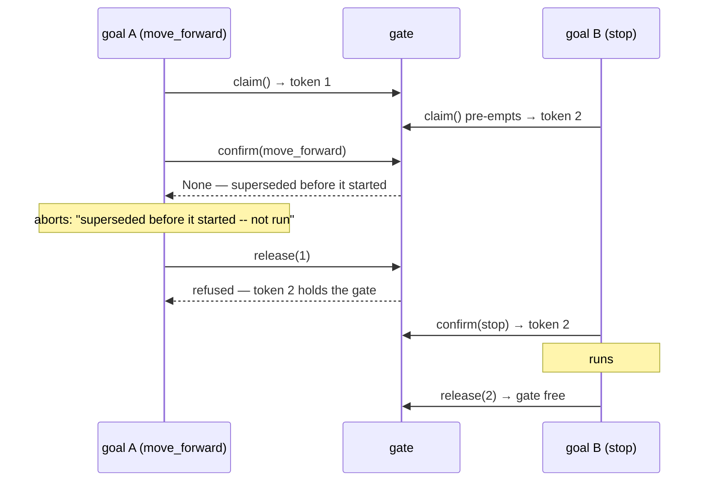
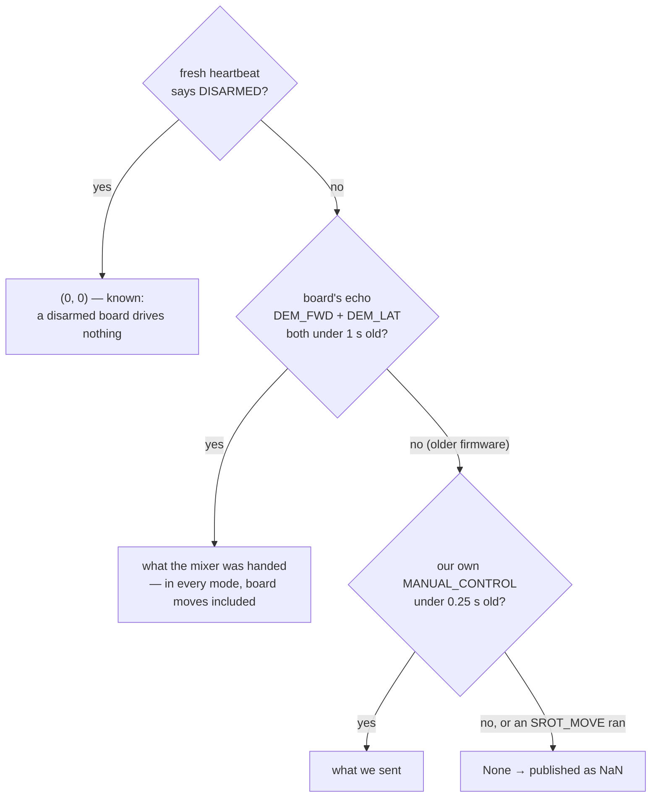

# mongla_manager — the node that owns the vehicle

**[`src/mongla_manager`](../../../../src/mongla_manager)**

Exactly one process in the running system holds the link to the flight-control board. This is
it. Everything else — the CLI, a mission, a state machine, the web console — asks *this* node
over one ROS action, and it decides what actually reaches the hull.

That is a deliberate constraint, not an accident of history. Two processes writing motion
commands to the same vehicle is the kind of bug that looks like a broken sensor.

---

## What happens when you send a command

```
mongla arm ─────► /mongla/move (action) ─────► auv_manager_node
                                                    │
                                    ┌───────────────┼────────────────┐
                                    ▼               ▼                ▼
                          not a verb:        run ON THE BOARD   run HERE as a
                          Unknown command    as one primitive   host-side loop
```

The node answers three questions for every goal:

1. **Is this a verb at all?** A name that is not in the registry fails with
   `Unknown command` and puts nothing on the wire — a mission written for the old backend
   fails by name instead of silently doing nothing.
2. **Can the board do it better than we can?** Eleven verbs — the moves, turns, `set_depth`,
   `stop`, `pause`, `style_roll` — collapse into a single on-board primitive. The board runs
   and brakes the motion itself at 500 Hz and reports when it is done.
3. **Otherwise, run it here.** Vision alignment is the important case: a loop on this node
   streams axis demands while the board stabilises underneath.

### One verb at a time, and only its owner can free the gate

Goals arrive on their own threads, so the node keeps a **gate**: the verb that claims it gets a
token, and only the holder of that token can release it. That is what stops a pre-empted verb
from freeing the gate its successor now holds (B-84). An unknown verb is refused before it
claims anything. While a verb runs, any other verb is rejected, except `stop`, `disarm` and
`surface`, which are accepted and pre-empt it.



## What it publishes

| Topic | What | Notes |
|---|---|---|
| `/mongla/state` | armed, mode, heading, depth, battery | on change plus a heartbeat; a missing number is `NaN`, never `0.0` |
| `/mongla/imu` · `/mongla/imu_rates` | the board's inertial data | stamped with the board's own clock where available |
| `/mongla/demand` | the forward and lateral demand in force on the board, `NaN` when unknown | the estimator uses it to predict motion; see *where the demand comes from* below |
| `/mongla/esc_rpm` | per-thruster RPM | from the board's ESC telemetry; a message count never proves a thruster is alive |
| `/mongla/board_link` | what the link carries now: bytes/s against the 11520 the line can carry, frames/s per message type, the board's own drop rate and error count, and every `NAMED_VALUE_FLOAT` channel with its age | once a second, over a 4 s window (`link_meter.py`). A channel silent for 3 s is `NaN` with its age, never its last value; drop and errors are `NaN` until `SYS_STATUS` arrives. Batighor's `board_link` layout draws it |
| `/diagnostics` | the health board, every subsystem every second, as `diagnostic_msgs/DiagnosticArray` | a subsystem that is not reporting is STALE (level 3), never OK; Foxglove's Diagnostics panel draws it and `pool_record.sh` keeps it |
| `/mongla/flare_order` | the competition order received over the radio | latched |

### Where the demand comes from

The command-velocity model and the ZUPT gate both need to know what the thrusters are being
asked for, and must hear *unknown* rather than a guess. `SrotFC.demand()` asks three sources,
best first:



The echo outranks our own record because in AUTO the board **discards** MANUAL_CONTROL: the
record would be a confident demand the thrusters never saw. The echo needs firmware with
[srot-control-board#33](https://github.com/RakibulIslam1/srot-control-board/pull/33); without
it, behaviour is exactly as before.

## Entry points

| Command | What it does |
|---|---|
| `ros2 run mongla_manager start` | the node itself (also `auv_manager`, `auv_manager_node`) |
| `ros2 run mongla_manager connect` | open the board's link and print everything it sends — no ROS graph, no built workspace needed. `--watch` for live, `--json` for machines |
| `ros2 run mongla_manager bringup_check` | preflight that grades each subsystem and exits non-zero on a real fault; the board is checked whenever one answers (`--skip-mavlink` skips it, `--strict` fails on a WARN) |
| `ros2 run mongla_manager autotune` | run the board's own gain tuning, in water, behind a typed confirmation |
| `ros2 run mongla_manager flare_order` | send the competition's flare order to the vehicle over the radio |

`connect` **reports**; `bringup_check` **grades and gates**. Use the first to look, the second
to decide.

## The map

| File | Role |
|---|---|
| `auv_manager_node.py` | the node's core: link ownership, the reader thread, the action server, dispatch, shutdown |
| `node_setup.py` | bring-up: every node parameter, the board link, the recorder, the preflight reads |
| `node_telemetry.py` | what is published: `/mongla/state`, imu, esc_rpm, demand, the console blocks |
| `node_vision.py` | the vision state the verbs read, and the uplinks to the board |
| `node_health.py` | the health report and the two watchdogs |
| `node_support.py` | the node's shared constants and the heartbeat thread |
| `bringup_check.py` | the preflight: its sections in order, and the exit code |
| `bringup_host.py` · `bringup_board.py` · `bringup_grade.py` | the checks of the computer, the checks of the board, and the PASS/WARN/FAIL line they all report in |
| `srot_connect.py` · `srot_format.py` · `srot_changes.py` | reading the board, formatting it, showing what changed |
| `srot_autotune.py` | the operator's front end to the board's tuning routine |
| `srot_recorder.py` | raw MAVLink capture for later analysis |
| `vision_state.py` | per-camera detection cache: the subscriptions and what they last said |
| `vision_choice.py` | which box to steer on, turned into a pixel error (`bbox_error`, `Sample`) |
| `distance_state.py` | distance travelled, from the downward camera |
| `vision_tunables.py` | the live-tunable vision gains, in one place; set on the deck under `nodes:` in `bringup.yaml` |
| `dispatch_policy.py` | which goals the action server accepts while busy: only `disarm`, `stop` and `surface`, which pre-empt the running verb |
| `health.py` · `health_reporters.py` | subsystem health, reported rather than assumed |
| `kutum_health.py` | Kutum, the Pi and its Hailo-8, as one group in the same report: `kutum.pi_temperature` (the Pi firmware's 80 and 85 C), `kutum.pi_power`, `kutum.hailo` (graded by the zones and throttling levels the chip reports), `kutum.disk`, and `kutum.clock` (the RTC cell, the RTC against the system clock, and any wall-clock move during the session), the Pi power and disk rows with the preflight's own grades. Sampled every 10 s on its own thread, because `vcgencmd` can take as long as the executor's stall limit. Report-only: nothing acts on these rows |
| `connection_config.py` | connection profiles and network constants |
| `mongla_localization/launch_defaults.py` | reads `~/.mongla/bringup.yaml` for bringup and every other launch file (it lives in the package they all depend on) |
| `yaw_source.py` | heading, read off the board's own fused attitude |
| `estimator/thrust_model.py` | eight signed ESC RPMs to a body-frame acceleration, for the estimator |
| `flare_order_send.py` | `ros2 run mongla_manager flare_order R-B-Y` -- tells the vehicle the flare order |
| `launch/bringup.launch.py` | the whole vehicle: control, optional vision, optional localization |

## Running it

```bash
# the vehicle, with vision and the localization filter
ros2 launch mongla_manager bringup.launch.py vision:=true

# control only — the smallest useful system
ros2 run mongla_manager start

# is the board healthy enough to arm?
ros2 run mongla_manager bringup_check
```

Every capability in the launch file is a switch with a default we can defend. Bring the
vehicle up bare, then add one at a time.

## Testing

```bash
python3 -m pytest -q src/mongla_manager/test
```

No test needs hardware: the board, the cameras and the ROS graph are all faked at
their real boundaries. Several tests read the documentation in `.claude/context/` and fail
when a documented constant no longer matches the code.

---

Related: [`mongla_control`](../mongla_control/README.md) (what the verbs actually do) ·
[`mongla_interfaces`](../mongla_interfaces/README.md) (the action) ·
[The Shift](../../the-shift.md)

## Every module

<!-- modules:begin -->
Generated from each module's docstring by `tools/ci/gen_reference.py`; a module
with no summary line shows as *(no summary)* until it gets one.

| module | what it is |
|---|---|
| `auv_manager_node.py` | AUV Manager Node -- Terminal 1. |
| `bringup_board.py` | Bringup checks of the SROT board (`bringup_check`): firmware, barometer, depth loop, failsafe, memory. |
| `bringup_check.py` | the pre-flight gate for the SROT vehicle. |
| `bringup_grade.py` | How every bringup check reports: a grade and one aligned line. |
| `bringup_host.py` | Bringup checks of the computer itself: ROS, disk, drivers, cameras, models, the Hailo, power. |
| `connect_report.py` | What `connect` prints: the vehicle, one section per subsystem. |
| `connection_config.py` | How the manager finds the SROT board. |
| `dispatch_policy.py` | Pure goal-acceptance policy for the /mongla/move action server. |
| `distance_state.py` | manager-side bridge to the downward distance estimator. |
| `flare_order_send.py` | ``ros2 run mongla_manager flare_order R-B-Y --port /dev/ttyACM0`` -- tell the vehicle. |
| `health.py` | One health surface. Four states, and UNKNOWN is not OK. |
| `health_reporters.py` | Each subsystem's private dialect, translated once. |
| `kutum_health.py` | Kutum in the live health report: the Pi and the Hailo-8 on it, as one machine. |
| `link_meter.py` | What the SROT link is carrying now: bytes and frames per second, per type. |
| `node_action.py` | The /mongla/move action server: which goals run, how they stop, what they report. |
| `node_health.py` | Is the node alive, and is the mission: the health report and the three watchdogs (executor, mission, kill switch). |
| `node_setup.py` | Bringing the node up: parameters, the board link, the recorder, the preflight reads. |
| `node_support.py` | The manager node's shared constants: one home, read by every part of the node. |
| `node_telemetry.py` | What the node publishes about the vehicle: state, IMU, demand, and the console blocks. |
| `node_vision.py` | The vision side of the node: the vision state the verbs read, and the uplinks to the board. |
| `srot_autotune.py` | ``ros2 run mongla_manager autotune`` -- run the board's relay AUTOTUNE, deliberately. |
| `srot_changes.py` | Detect what CHANGED between two SROT telemetry snapshots. Pure, no I/O. |
| `srot_connect.py` | ``ros2 run mongla_manager connect`` -- point at the SROT board, see the vehicle. |
| `srot_format.py` | One place that decides how a SROT value is rendered. Pure, no I/O, no pymavlink. |
| `srot_recorder.py` | Record the raw MAVLink stream so a dive can be replayed after the fact. |
| `vision_choice.py` | Which box the control loop steers on, and the Sample it is turned into. |
| `vision_state.py` | per-camera subscriber that the vision motion loop reads. |
| `vision_tunables.py` | ROS-param defaults for every vision_* command. |
| `yaw_source.py` | Heading, read off the board's own fused attitude. |
| `estimator/thrust_model.py` | Eight signed ESC RPMs -> a body-frame acceleration for the estimator. |
<!-- modules:end -->
