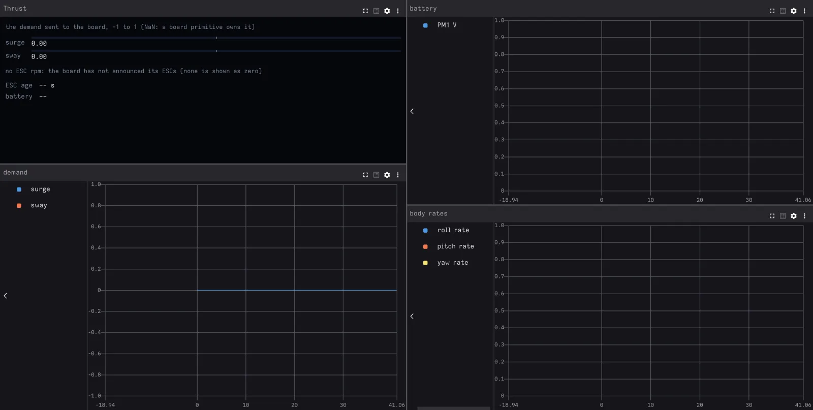
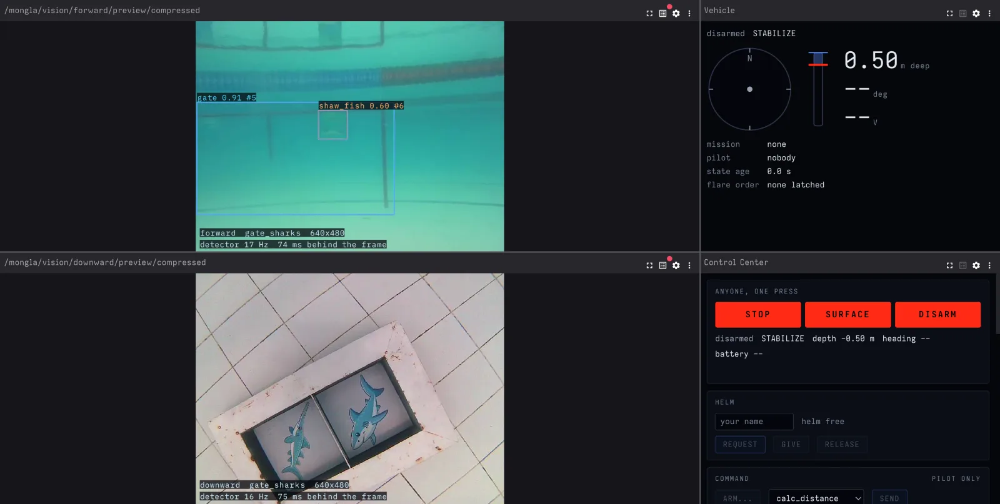
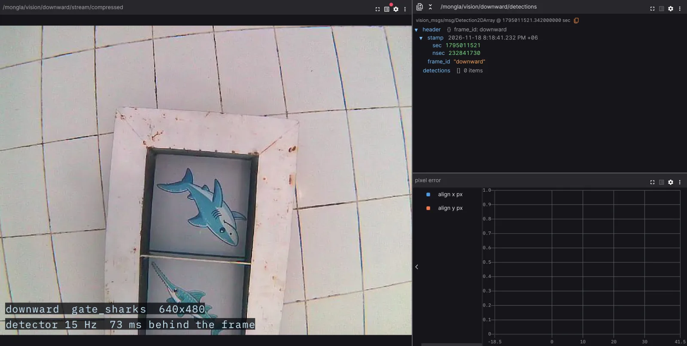
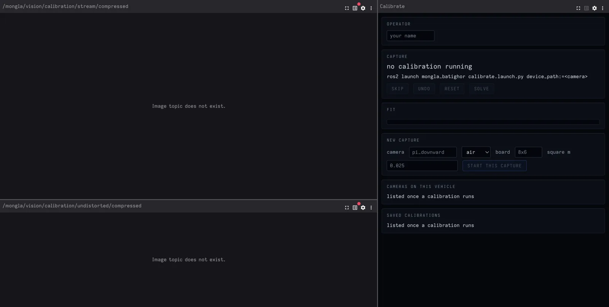

# Batighor, view by view — what the operator sees

Batighor is the operator center: Kutum serves Lichtblick with our panels, our theme
and one view per aspect of the vehicle, to any browser on the deck
(`http://mongla.local:8000/`) or to the desktop app
(`python3 tools/pool/batighor_desktop.py`). This page walks the views as an operator
meets them. Every picture is the desktop app at its working scale, on Kutum, with the
stack running against the bench's fake board and two recorded pool clips played
through the real cameras, detectors, tracker and flow node. The board, the depth and
the motion in them are the fake board's; the pictures and the boxes are real.

**State: RUNS TODAY on the bench.** Nothing here has seen water. What water must
decide about it is in [First pool day](first-pool-verification.md).

The rules every view keeps:

- **Nothing is left off.** A detection, a box below the detector's floor, a track the
  tracker is only predicting: each is drawn and each says what it is.
- **Absence is said, not drawn as zero.** A missing number reads `--`; a stage that is
  not running is struck through with the switch that turns it on; a panel with no
  source names the node it is waiting for.
- **One unit per plot, and a title on each.** A plot has one axis; two units on it
  flatten the smaller one. The title says what the plot is, so a legend label names
  only its line and fits (`test_views.py` fails a view that breaks either).
- **No label covers another.** Each box's label takes the first free place above,
  below or inside its box, and none leaves the picture (`test_overlay.py`).
- **The picture and its boxes are the same frame.** The camera's own JPEG, with the
  annotations drawn by the browser from the frame they were computed on.

## The cockpit (`mongla_layout`)

The view the app opens on. The cameras take the left column whole; the right column
is what to do and what the vehicle is doing.

- **Control Center**: STOP, SURFACE and DISARM first and pinned, for anyone, one press.
  Below them the helm (a name, then Request, Give, Release), arming behind two ticks,
  every verb with its own fields, missions, the live camera and the detectors'
  settings, and the log.
- **Vehicle**: armed and mode, a compass, a depth gauge, the numbers, the mission
  running (by its beat on `/mongla/mission_alive`) and who holds the helm.
- **Vision**: per camera, the lock ladder's rungs (detection, held, follow, anchor,
  lost) lit in the rung's colour, the identity held and its authority, the model and
  its epoch, and every perception stage: lit when a node publishes it, struck through
  when not, with the bringup switch beside it (`lock:=true`).
- **Over each camera**: every box in its class's colour with its score and track,
  the stats at the bottom left (camera, model, size; the detector's rate and how far
  its boxes are behind the frame), and on the downward camera the flow node's tracked
  points, anchor to now, with their count.

## Vision (`vision`)

Detection and tracking in depth. The two pictures are drawn synchronised: each frame
waits for its own annotations, so a box never sits on the wrong frame. On the right,
the ladder's history per camera, then one plot per quantity, each titled with what it
is: the lock's authority, the target's range in metres, its bearing and yaw in
degrees, the anchor's rotation and scale, and the pixel errors (a vision verb's
alignment and the solver's reprojection).

## Flow (`flow`)

The downward camera as a speed sensor. Each tracked point is a segment from where it
was on the anchor frame to where it is now; the plots are the flow's velocity beside
the filter's, the distance travelled, where the velocity scale came from (here
`uncalibrated`, said in words), the quality with the heights, and the number of
tracks on an axis of its own.

## Localization (`localization`)

Where the filter puts the vehicle, in 3D and as a north-up plan, and why: which
sources aid it (`aided (flow uncalibrated)` here), its position, its velocity beside
the flow's, the board's heading beside the one given, and the floor's height against
the depth.

## Thrust (`thrust`)

The demand sent to the board, centred bars from -1 to 1, and one bar per ESC the
board reports. The bench board announces no ESCs, so the panel says so instead of
drawing zeros.

## Board health and link (`board_health`, `board_link`)

Every subsystem graded by the manager, worst first, each with its evidence; Kutum's
rows below (its clock and RTC cell, disk, the Hailo's temperature and clock, power
and temperature). `UNKNOWN` is a state, not a failure: on the bench there is no
second board, so the kill switch is unseen, and the panel says that.

The one USB-C line: its use against capacity, the board's drops and errors, the
frames per second of each message and the board's named channels with their age.

## The small views

`weak_link` is the one to open over a poor connection: the cameras' small previews,
the Vehicle panel and the Control Center, and nothing heavy.

`bins_downward` is the downward camera at full size for a bin task, with its raw
detections and a vision verb's pixel error.

`calibrate` runs a camera calibration from the browser. With none running it says so
and gives the command that starts one.

## What the pictures do not show

- **The downward detections are filtered for these pictures.** The development model
  boxes the whole frame as `shark` on the bin clip, on either camera (measured, and
  a bead), so the docs shoot ran the downward detector without that class. On the
  vehicle Batighor draws whatever the model says, which is the truth about the model.
- **No lock, no pose, no anchor.** The bench ran without `lock:=true`, which is why
  those stages are struck through and their plots are empty.
- **The bench board, not the hull.** Depth, heading, battery and rates are the fake
  board's; the ESC panel is empty because it announces none.

Code: [`mongla_batighor`](../packages/mongla_batighor/README.md). Running it on a
pool day: [Operator tooling](foxglove-and-bags.md).
