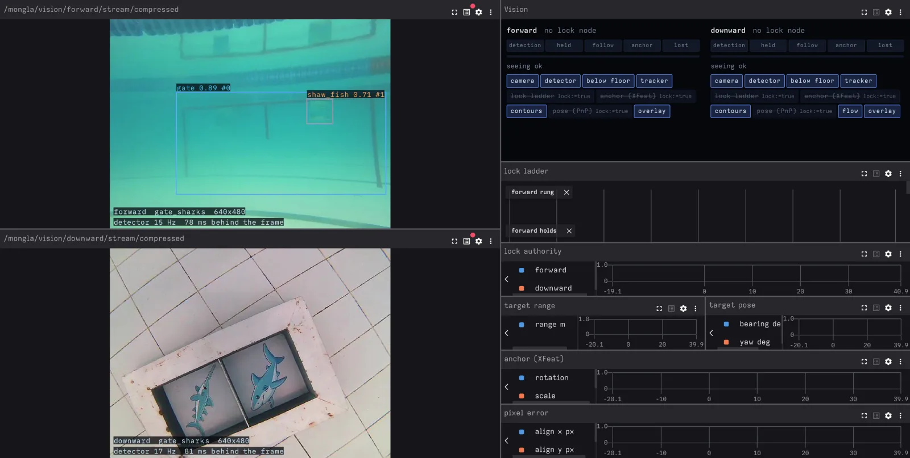
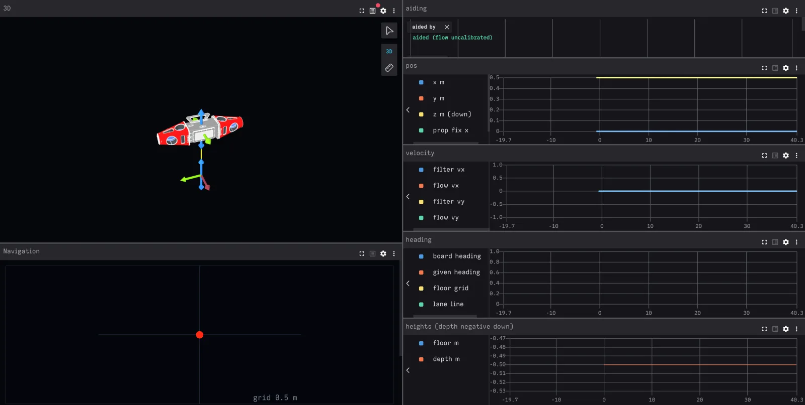
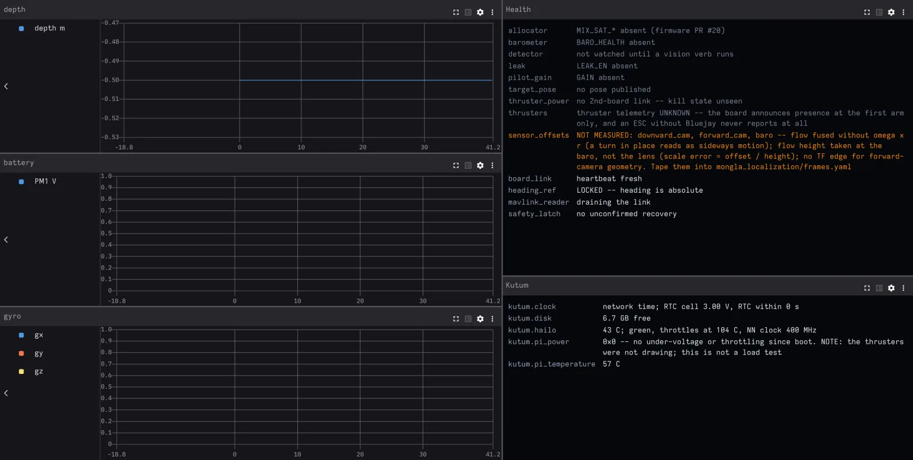
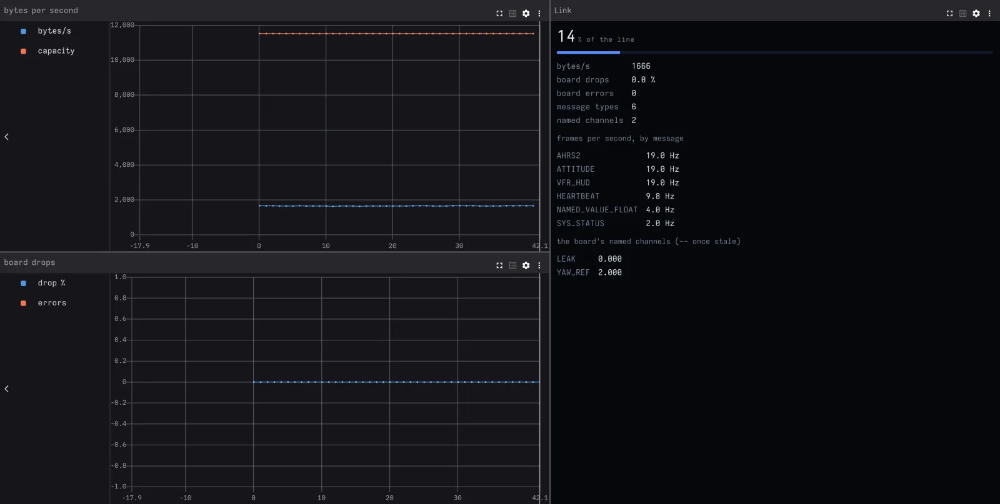
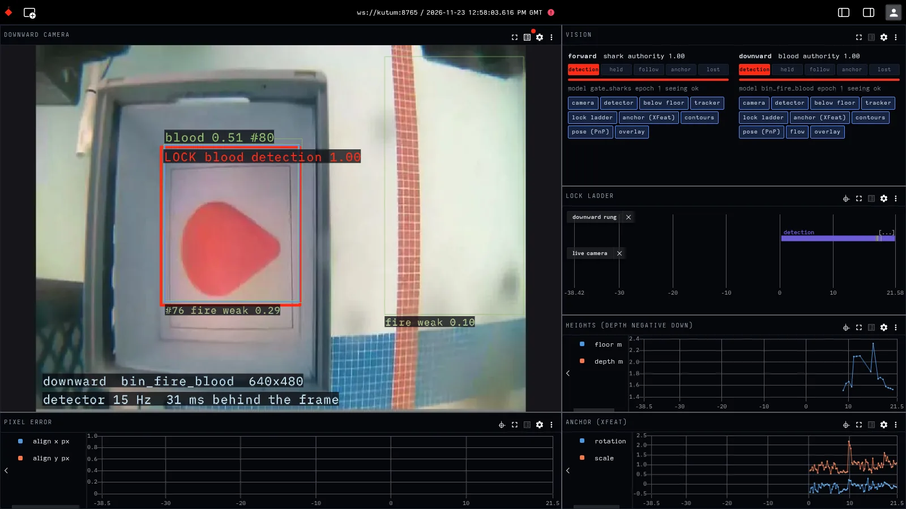

# Batighor, view by view — what the operator sees

Batighor is the operator center: Kutum serves Lichtblick with our panels, our theme
and one view per aspect of the vehicle, to any browser on the deck
(`http://kutum.local:8000/`) or to the desktop app
(`python3 tools/pool/batighor_desktop.py`). This page walks the views as an operator
meets them. Every picture is the desktop app at its working scale, on Kutum, with the
stack running against the bench's fake board and two recorded pool clips played
through the real cameras, detectors, tracker and flow node. The board, the depth and
the motion in them are the fake board's; the pictures and the boxes are real.

**State: RUNS TODAY on the bench.** Nothing here has seen water. What water must
decide about it is in [First pool day](first-pool-verification.md).

The rules every view keeps:

- **Nothing is left off.** A detection, a box below the detector's floor, a track the
  tracker is only predicting: each is drawn and each says what it is.
- **Absence is said, not drawn as zero.** A missing number reads `--`; a stage that is
  not running is struck through with the switch that turns it on; a panel with no
  source names the node it is waiting for.
- **One unit per plot, and a title on each.** A plot has one axis; two units on it
  flatten the smaller one. The title says what the plot is, so a legend label names
  only its line and fits (`test_views.py` fails a view that breaks either).
- **No label covers another.** Each box's label takes the first free place above,
  below or inside its box, and none leaves the picture (`test_overlay.py`).
- **The picture and its boxes are the same frame.** The camera's own JPEG, with the
  annotations drawn by the browser from the frame they were computed on.

## The cockpit (`mongla_layout`)

The console's first tab (`/` opens the console, `batighor`: the status strip over a tab per
view), in three columns read left to right: the two cameras,
each column as wide as its 16:9 pictures (the vehicle profiles' 640x360, read from `cameras.yaml` by the test); the Control Center at full height; and the
vehicle's numbers and attitude over the Vision panel and the lock authority it holds with.

- **Control Center**: STOP, SURFACE and DISARM first and pinned, for anyone, one press,
  one row of three keys sized by the panel's width, each saying under its name what
  it does (hold here; go up, stay up; motors off). Below them the helm (a name, then
  Request, Give, Release), arming behind two ticks, every verb with its own fields,
  missions, and the log: every press at the helm (the last 200 lines, kept on Kutum and
  sent whole to a browser that joins late) merged by time with every node's warnings and
  errors from `/rosout` (a node that repeats itself, digits aside, keeps one line with a
  count, `(x12)`). The live camera and the detectors' settings are the
  **Detectors** panel, on the Vision and Downward views: together they needed
  1042 px and showed a third of it.
- **Vehicle**: armed and mode, a compass, a depth gauge, the numbers, the mission
  running (by its beat on `/mongla/mission_alive`) and who holds the helm, centred in its
  panel; under them the board's own lines from `/diagnostics` (link, leak, kill line,
  barometer, heading reference, safety latch), one word each (ok, warn, fail, stale) with
  the full sentence on hover.
- **Vision**: per camera, the lock ladder's rungs (detection, held, follow, anchor,
  lost) lit in the rung's colour, the identity held and its authority, the model and
  its epoch, and every perception stage: lit when a node publishes it, struck through
  when not, with the bringup switch beside it (`lock:=true`).
- **Over each camera**: every box in its class's colour with its score and track,
  the stats at the bottom left (camera, model, size; the detector's rate and how far
  its boxes are behind the frame), and on the downward camera the flow node's tracked
  points, anchor to now, with their count.

## The plan beside the pool (`mission`)

Read left to right: where, what the plan says, what the vehicle is doing about it.

- **Map**: the pool from the course file, its floor soundings and props (measured
  solid, nominal dashed amber, unplaced named below), and Mongla: solid once anchored
  in the pool, a hollow hull "by its start" before.
- **Mission text**: the running mission's file as its runner published it
  (`/mongla/mission/source`), numbered, and the line that sent the verb running now
  marked and scrolled to (`/mongla/mission/line`). A run that stopped stays on the
  line it stopped at, marked "ended", for as long as the panel is open. A helper the
  mission calls in another file reads as the mission's line that called it.
- **Mission**: the task and its clock, the verb with what it was asked, and every
  recent verb with how it ended, refusals in red with their reason.

A panel shows what a topic last said even when it opens after the message:
Lichtblick hands a panel only what arrives after it mounts, so the instruments keep
the last message of each topic, with when it came, and give it to a panel that opens
later. An old message keeps its age.

## Vision (`vision`)

Detection and tracking in depth. The two pictures are drawn synchronised: each frame
waits for its own annotations, so a box never sits on the wrong frame. While a
detector is silent (paused until a mission asks), the overlay marks each frame
itself and says so, so the picture still shows. Beside them two columns: the Vision
panel over the ladder's history, every row in view; and the Detectors panel (the
live camera and each detector's settings) over one plot per quantity, each titled with what it
is: the lock's authority, the target's range in metres, its bearing and yaw in
degrees, the anchor's rotation and scale, and the pixel errors (a vision verb's
alignment and the solver's reprojection).

## Flow (`flow`)

The downward camera as a speed sensor. Each tracked point is a segment from where it
was on the anchor frame to where it is now; the plots are the flow's velocity beside
the filter's, the distance travelled, where the velocity scale came from (here
`uncalibrated`, said in words), the quality with the heights, and the number of
tracks on an axis of its own.

## Localization (`localization`)

Where the filter puts the vehicle, in 3D and as a north-up plan, and why: which
sources aid it (`aided (flow uncalibrated)` here), its position, its velocity beside
the flow's, the board's heading beside the one given, and the floor's height against
the depth.

On the hull in 3D, an arrow from its origin is the demand: where the board is told
to push and what share of full force, with the words under it. While the board runs
a move in AUTO it owns the demand and reports none here, so the scene says
`demand unknown` and draws no arrow. The cameras' frusta and the detections are not
in the scene: both need where each camera sits on the hull and which way its
picture points, and neither is measured yet (`frames.yaml`).

## Thrust (`thrust`)

The cost is the thruster pack (PM2, `/mongla/thruster_pack`, a `sensor_msgs/BatteryState`), not the
electronics rail the Health view plots beside it. The demand sent to the board, centred bars from -1 to 1, and one bar per ESC the
board reports. The bench board announces no ESCs, so the panel says so instead of
drawing zeros.

## Board health and link (`board_health`, `board_link`)

Every subsystem graded by the manager, worst first, each with its level in words (ok, warn,
fail, unknown) and its evidence; Kutum's
rows below (its clock and RTC cell, disk, the Hailo's temperature and clock, power
and temperature). `UNKNOWN` is a state, not a failure: on the bench there is no
second board, so the kill switch is unseen, and the panel says that.

The one USB-C line: its use against capacity, the board's drops and errors, the
frames per second of each message and the board's named channels with their age.

## The small views

`weak_link` is the one to open over a poor connection: the cameras' small previews,
the Vehicle panel and the Control Center, and nothing heavy. Any view also slows its own
video when the link cannot keep up. The status strip's **to kutum** cell shows this
screen's lag behind the vehicle, measured from the state's own stamp, and the helm halves
the cameras' viewer stream while any screen lags. Detection is never slowed; the package
page has the rule.

`downward` is everything under the hull, for the bins, the floor markers and any
target below: the downward camera across the top at its 16:9 shape, synchronised with its boxes, the alignment error under it, and
beside it the Vision panel, the downward camera's ladder and which camera is live, a
vision verb's pixel error, the floor height against depth, and the anchor's rotation
and scale.

`calibrate` runs a camera calibration from the browser. With none running it says so
and gives the command that starts one.

## Inspect and Log

`inspect` is for a question no view was built for: Lichtblick's topic graph across the
whole width (every node and topic as the bridge sees them), and under it the source's
topics with their rates beside the raw message on any topic, `/mongla/state` first.

`log` is the whole record at full height: every node's `/rosout` at info and above, in
Lichtblick's own log panel with its level and text filters, beside the Control Center,
whose log keeps only the helm and the warnings.

## What the pictures do not show

- **The downward detections are filtered for these pictures.** The development model
  boxes the whole frame as `shark` on the bin clip, on either camera (measured, and
  a bead), so the docs shoot ran the downward detector without that class. On the
  vehicle Batighor draws whatever the model says, which is the truth about the model.
- **No lock, no pose, no anchor.** The bench ran without `lock:=true`, which is why
  those stages are struck through and their plots are empty.
- **The bench board, not the hull.** Depth, heading, battery and rates are the fake
  board's; the ESC panel is empty because it announces none.

Code: [`mongla_batighor`](../packages/mongla_batighor/README.md). Running it on a
pool day: [Operator tooling](foxglove-and-bags.md).
