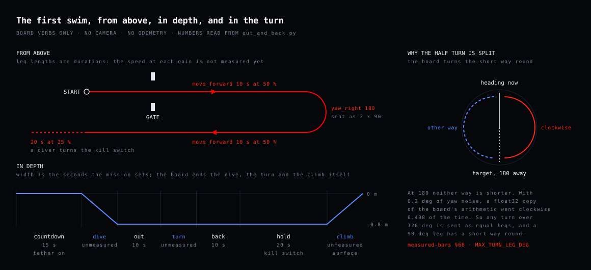
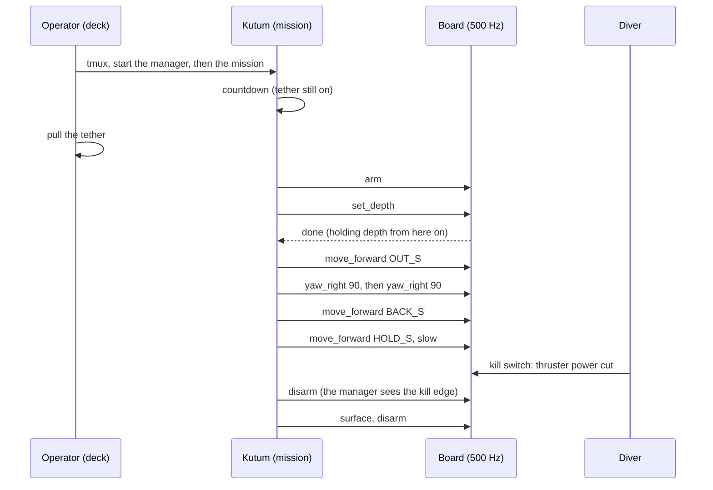

# The first swim — control only, as a script

The first time the vehicle swims a route, it does it with the board, Kutum and the
thrusters and nothing else: dive, swim straight, turn clockwise half a turn, swim
back, then keep the thrusters running slowly until a diver turns the kill switch.
No camera steers it and no odometry tells it where it is. The mission is
`out_and_back` (`src/mongla_planner/mongla_planner/missions/out_and_back.py`).

**BUILT, NEVER FLOWN.** Every duration and gain in the mission is a guess until
this page has been run once and its numbers written down.



The drawing is generated by `tools/site/make_diagrams.py`, which reads the numbers out of
`out_and_back.py`; change a constant there and re-run it.

---

## Why this run is simple, and what it depends on

A swim like this needs two reflexes: hold this depth, and hold this heading. Both
run on the board at 500 Hz, with the IMU and the barometer in hand. The Pi does
not steer at all here. It does one thing: it says *what to do next*, one verb at
a time, and waits for the board to say it is done.

So the run depends on four things only, and each has a check below:

| what | what can go wrong | where it is checked |
|---|---|---|
| the board | the automatic mode's depth loop has never run closed under this stack; every move closes it | step 2 |
| Kutum | the mission dies when the tether is pulled | step 4 |
| the thrusters | the mixer is for a different hull, or an axis is inverted | step 2 |
| the kill switch | power is cut but the board stays armed | step 6 |

The ranked list of firmware items that can end this run is in
[`upstream/control-only-swim.md`](../upstream/control-only-swim.md).

## Who does what, in order



Two details in that picture are deliberate.

- **The countdown runs before `arm`.** The board refuses every move while
  disarmed, so a wait that is itself a board verb (`pause`) would be refused.
  The countdown is a host-side wait (BUGS B-89).
- **The half turn is two quarter turns.** The board aims a relative turn at the
  shortest way round. At exactly 180 degrees there is no shortest way, and in a
  float32 simulation of the board's arithmetic the direction came out clockwise
  only half the time. Any turn wider than 120 degrees is split into equal legs
  (measured-bars §68).

## 1. Deploy and check the machine

On the dev box, with Kutum on the network:

```bash
kutum/deploy.sh fh1m@mongla.local              # sync + doctor + build + gate
```

Deploy stops on a doctor FAIL. The doctor also reads the RTC: once the tether
is off, Kutum has no network and its clock is the RTC, so the RTC battery and the
RTC-to-system offset are checked here, not on the day.

## 2. The board, on the bench, with props off

```bash
ros2 run mongla_manager connect --watch       # look
ros2 run mongla_manager bringup_check  # decide: exits non-zero on a fault
```

Read, in this order:

1. **Behaviour revision** at or above the floor. Below it, every turn goes the
   wrong way.
2. **Barometer healthy.** An unhealthy barometer makes the board refuse every
   move while still arming: the vehicle arms and does nothing.
3. **`FRAME_REVERSE` is 1** on this hull, and the motor directions were not
   changed to cancel it.
4. **The two armed depth checks** in
   [`srot-integration.md`](srot-integration.md#bench-bring-up-runbook-each-step-gates-the-next)
   (step 4 there). Every move in this mission closes the depth loop, including
   the straight legs. Until both checks pass, this page stops here.
5. **The mixer matches the hull in the water.** The firmware mixes for eight
   thrusters, the old Dubomini matrix. The Mongla hull has five in the CAD and
   seven when finished, and its mixer is open as
   [srot-control-board#39](https://github.com/RakibulIslam1/srot-control-board/pull/39).
   Which hull swims, and which `FRAME_CLASS` the board runs for it, is a decision,
   not a check, and it has to be made before step 5.

## 3. The kill switch, on the bench

With props off and the board armed from the CLI:

```bash
ros2 run mongla_planner mongla arm
```

Turn the kill switch. Within a second the manager logs `[KILL ]` and
disarms (it looks twice a second). Restore power: nothing moves, because nothing is armed. If the log line
does not appear, `connect --watch` shows whether the board ever reported the
kill switch at all (`kill switch --` means the second board is not heard).

## 4. Start it so it survives the tether

On Kutum, over ssh, inside tmux:

```bash
tmux new -s run
ros2 launch mongla_manager bringup.launch.py localization:=false   # pane 1
ros2 run mongla_planner mission out_and_back                       # pane 2
```

`localization:=false` keeps the run to what it needs; the filter is read-only
and commands nothing, so leaving it on is harmless, but it is one less process
on the deck.

**Warning:** run outside tmux and the countdown refuses. That is the point:
pulling the tether ends a bare ssh session, the mission dies with it, and after
3 s of silence the manager surfaces the vehicle. Detach with `Ctrl-b d`; the
run carries on.

## 5. During the run

| you see | it means | you do |
|---|---|---|
| countdown ticking | tether still on, nothing armed | pull the tether before it ends |
| `[CMD  ]` lines, `[STATE]` depth near `DEPTH_M` | the board holds depth | watch the hull, not the laptop |
| a goal `FAILED` with the board's refusal in the message | the board refused, usually the barometer | the mission stops, surfaces and disarms; read `connect --watch` after |
| hull drifting down or up mid-leg | the depth loop, not buoyancy, until shown otherwise | kill switch |
| anything you did not expect | — | kill switch |

The board surfaces on its own after 5 s without a host heartbeat, on a leak, and
on a sagging thruster battery, whether or not Kutum is alive.

## 6. The end

The last leg is a slow forward run so the thrusters are visibly turning. The
diver turns the kill switch; every thruster stops because the power is cut. The
manager sees the edge and disarms, so turning the knob back cannot resume the
move. The mission's own cleanup then calls `surface` and `disarm`.

## 7. Write the numbers down

The first run is a measurement, not a performance. Before the second:

- **Straight leg:** distance against a tape for `OUT_S` at `GAIN`. Set `BACK_S`
  from it, not from hope.
- **The turn:** on the outside camera, was it clockwise, and how far did it
  overshoot? A turn that never reaches its target is reported done at 100 %
  ([srot-control-board#36](https://github.com/RakibulIslam1/srot-control-board/issues/36)),
  so check it on the outside camera, not in the log.
- **Depth:** held within what band, on each leg.

Each goes in [`measured-bars.md`](../measured-bars.md) with its conditions, and
the constant in `out_and_back.py` changes in the same commit.

Related: [`pool-day.md`](pool-day.md) ·
[`first-pool-verification.md`](first-pool-verification.md) ·
[`srot-integration.md`](srot-integration.md) ·
[`mission-cookbook.md`](../missions/mission-cookbook.md)
