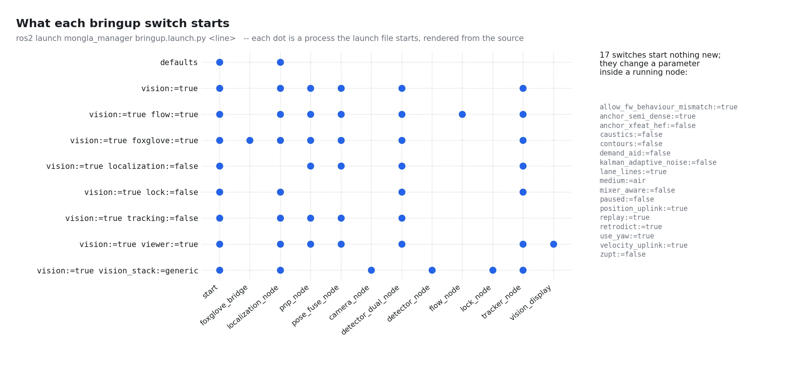

# The operator runbook — every command, verified

**Tested two ways.** Every switch alone and every pair of switches (1200
pairs) is rendered the way `ros2 launch` would run it, conditions and includes
and all, with no process started: `test_every_switch_combination_renders.py`.
A pair that raises, or a switch that no longer starts the node it names, fails
the build. And every command on this page is checked by `tools/command_lint.py`: the launch
file exists, every `name:=value` is a declared argument (`ros2 launch` ignores
an undeclared one **silently**), choices are respected, every model has its
`<stem>.yaml` sidecar, every verb flag is a real field, every mission exists.
`test_operator_commands_are_real.py` fails the build if one drifts.

The complete generated list of arguments, defaults, verbs, missions and node
parameters is [`reference/commands.md`](../reference/commands.md). This page is
the **order you run them in**.



The figure is rendered from the same walk the test does, so it cannot drift
from the launch files: `python3 tools/fig_launch_switches.py` (after a
launch-file change).

The vehicle: SROT board (Hengla) over one USB-C cable, Raspberry Pi 5 with a
Hailo-8, forward and downward cameras.

---

## 0. Every terminal

```bash
cd ~/Ros_workspaces/mongla_ws
source install/setup.bash
source scripts/pool_session.sh gate_practice_am   # same label in every terminal
```

`pool_session.sh` puts the bag, the scorecard and every node's log for this run
in one folder, `~/mongla_runs/<label>`. Source it — executing it does nothing.

---

## 1. Before anything arms

```bash
ros2 run mongla_manager connect --watch          # everything the board sends; Ctrl-C to stop
ros2 run mongla_manager bringup_check            # grades each subsystem; exits non-zero on a FAIL
ros2 run mongla_manager bringup_check --strict   # a WARN is also a failure: the pre-mission gate
```

`connect` **reports** and always exits 0. `bringup_check` **grades**. Look with
the first, decide with the second. Read the firmware revision, `FRAME_REVERSE`
and barometer health off them before arming — an unhealthy barometer refuses
every move verb (CLAUDE.md §2).

Propellers clear and a human on the kill switch before section 3.

---

## 2. Bring the vehicle up

**One launch owns the board:** `bringup.launch.py`. Bring it up bare, then add
one capability at a time.

| what you want | command |
|---|---|
| control only (board + `/mongla/move`) | `ros2 launch mongla_manager bringup.launch.py` |
| + both cameras and detectors | `ros2 launch mongla_manager bringup.launch.py vision:=true` |
| + a different forward model | `ros2 launch mongla_manager bringup.launch.py vision:=true fwd_model:=sauvc_sim` |
| + the downward camera's velocity | `ros2 launch mongla_manager bringup.launch.py vision:=true flow:=true pool_depth_m:=1.6` |
| + the lock ladder on one class | `ros2 launch mongla_manager bringup.launch.py vision:=true lock_class:=gate` |
| no localization | `ros2 launch mongla_manager bringup.launch.py localization:=false` |
| + Foxglove on ws://\<pi\>:8765 | `ros2 launch mongla_manager bringup.launch.py vision:=true foxglove:=true` |
| a named serial device | `ros2 launch mongla_manager bringup.launch.py mav_device:=/dev/serial/by-id/usb-1a86_USB_Serial-if00-port0` |
| on the bench, in air | `ros2 launch mongla_manager bringup.launch.py vision:=true medium:=air` |

Notes that cost runs when forgotten:

- **`flow`, `viewer`, `replay` and `lock_class` live inside the vision stack.**
  Without `vision:=true` they start nothing. The launch prints
  `WARNING: flow:=true has no effect: vision is off` rather than going ahead
  silently, but it does not stop.

- `pool_depth_m` is metres **from the downward camera to the floor**. Without
  it `flow_node` publishes quality 0 and refuses — by design.
- Both detectors start **paused**; the mission resumes the one it needs.
  `paused:=false` makes both infer and compete for the Hailo.
- `medium:=air` is for the bench only. It changes the refraction the vision
  nodes correct for.

### The same switches from a file

Typing twelve arguments at the pool is twelve chances to mistype one. Put them
in `~/.mongla/bringup.yaml` instead:

```yaml
vision: true
fwd_model: sauvc_sim
flow: true
pool_depth_m: 1.6
```

and run the bare `ros2 launch mongla_manager bringup.launch.py`. Precedence is
**command line > file > code default**. A misspelt key or a value outside the
allowed choices **refuses the launch** with the file and line named — unlike a
misspelt `name:=value`, which ROS ignores. Every key, commented, with its
default: `src/mongla_manager/config/bringup.example.yaml` (generated).

| | |
|---|---|
| use another file | `MONGLA_BRINGUP=~/venues/sauvc.yaml ros2 launch mongla_manager bringup.launch.py` |
| ignore the file | `MONGLA_BRINGUP=none ros2 launch mongla_manager bringup.launch.py` |

The launch prints which file it read, and every value it took from it.

### Every other knob: the same file, under `nodes:`

A launch argument switches a capability on. Everything else a node has (the
vision gains, the tracker's buffer, the filter's noise) is a **node
parameter**, and it goes in the **same file**, under `nodes:`, by node name.
There is no second file to remember:

```yaml
vision: true                         # launch arguments at the top level
pool_depth_m: 1.6
nodes:                               # node parameters, by node name
  mongla_manager:
    vision.kp_yaw: 80.0
    vision.coast_s: 0.6
  mongla_tracker_forward:
    track_buffer: 120
```

Each setting has exactly one home:

| what | where | when it takes effect |
|---|---|---|
| a capability or argument (`vision`, `pool_depth_m`, `conf`) | top level of `bringup.yaml`, or `name:=value` | at launch |
| a node parameter that is not an argument | `nodes:` in `bringup.yaml` | at launch |
| a vision gain, for one test | `ros2 param set /mongla_manager vision.kp_yaw 80.0` | the next vision goal; gone at restart |
| a value for one call in a mission | the verb's own argument (`vision.align(..., gain=30)`) | that call only |

Two mistakes that ROS lets through silently **stop the node** instead, with
the fix in the message:

- **a misspelt parameter** (`kp_yaww`): ROS would ignore it and run on the
  default. The node names the closest real one.
- **a parameter a launch argument already sets** (`vision.mixer_aware` under
  `nodes:`): launch's own value would win over yours. The node tells you to set
  the argument (`mixer_aware: false`) at the top level instead.

A wildcard node name (`/**`) is refused at launch, because it would reach every
node and no node could tell its own typo from another's real parameter. Every
node and its parameters: [`reference/commands.md`](../reference/commands.md) §4.
The vision gains, with their defaults, are at the end of the generated example.

A live `ros2 param set` that a node cannot apply is refused rather than
accepted and ignored. The tracker, for one, reads everything except `classes`
once at startup.

---

## 3. One verb at a time — the `mongla` CLI

Needs section 2 running. Each line is one `/mongla/move` goal.

```bash
ros2 run mongla_planner mongla arm
ros2 run mongla_planner mongla set_depth --target -0.5         # metres, negative below the surface
ros2 run mongla_planner mongla move_forward --duration 3 --gain 40
ros2 run mongla_planner mongla move_left --duration 2 --gain 40
ros2 run mongla_planner mongla yaw_right --target 90           # relative, degrees
ros2 run mongla_planner mongla turn --target 180               # absolute heading, shortest arc
ros2 run mongla_planner mongla head                            # read the heading
ros2 run mongla_planner mongla stop
ros2 run mongla_planner mongla surface
ros2 run mongla_planner mongla disarm
```

Vision verbs — a detector must be running and **resumed**:

```bash
ros2 run mongla_planner mongla vision_align --camera forward --target_class gate \
    --axes yaw,lat --err_px 40 --gain 30 --duration 20
ros2 run mongla_planner mongla vision_move --camera forward --target_class gate \
    --fwd_fill 40 --mode area --gain 35 --duration 20
```

`--fwd_fill` is **percent** of the frame the box fills when the verb stops
(40 = 40 %); `--err_px` is the centring tolerance in pixels.

Bench-only, disarmed at the surface:

```bash
ros2 run mongla_planner mongla calibrate_depth                 # re-zero the barometer
ros2 run mongla_planner mongla motor_test --target 1 --gain 20 --duration 2
ros2 run mongla_planner mongla fire --fire_channel 9           # BOARD channel N, 1..16
```

`fire` drives board channel N — the same N as `SERVOn_ROLE`. There is no
host-side map; read the role off `connect --watch` first.

A name that is not one of the 23 verbs fails at the node with `Unknown command`, and nothing
reaches the board. Every flag of every verb:
`ros2 run mongla_planner mongla <verb> -h`.

Live tuning applies on the **next** goal:

```bash
ros2 param set /mongla_manager vision.kp_yaw 80.0
```

---

## 4. Missions

```bash
ros2 run mongla_planner mission --list
ros2 run mongla_planner mission sauvc_qualification
ros2 run mongla_planner mission sauvc_full
```

Which missions exist and which models each loads (and which of those are not
shipped yet): the generated table, [`reference/commands.md` §3b](../reference/commands.md).
Every mission sends only real verbs with real kwargs —
`test_every_mission_runs_against_the_real_dsl.py` runs each one to prove it.

---

## 5. Record and replay

```bash
scripts/pool_record.sh record gate_run_1          # the debug allowlist, into $MONGLA_RUN_DIR
scripts/pool_record.sh record --full gate_run_1   # + raw images (large)
scripts/pool_record.sh list
scripts/pool_record.sh replay ~/mongla_runs/gate_practice_am/gate_run_1
```

To re-run the vision stack on a recorded bag instead of live cameras:

```bash
ros2 launch mongla_vision vision_pi.launch.py replay:=true
```

---

## 6. Vision without the board

For the desk, footage and tuning. None of these touch the board.

```bash
# both cameras, the vehicle's own vision stack
ros2 launch mongla_vision vision_pi.launch.py
ros2 launch mongla_vision vision_pi.launch.py fwd_model:=sauvc_sim paused:=false

# one camera, one model
ros2 launch mongla_vision vision.launch.py camera:=forward model:=gate_sharks classes:=gate,shark,shaw_fish

# one camera, two models, switched live by the mission
ros2 launch mongla_vision vision.launch.py camera:=forward models:=gate=gate_sharks,sauvc=sauvc_sim active_model:=gate

# archive footage through the full pipeline
ros2 launch mongla_vision video.launch.py fwd_video:=/path/clip.mp4 fwd_model:=gate_sharks

# the browser console on http://localhost:8090
ros2 launch mongla_vision mission_web.launch.py cameras:=forward fwd_model:=gate_sharks
```

Is the pipeline alive?

```bash
ros2 run mongla_vision vision_check --camera forward --require-class gate
```

Shipped models and their classes: `gate_sharks` (gate, shark, shaw_fish) ·
`bin_fire_blood` (blood, fire) · `sauvc_sim` (qual_gate, final_gate,
orange_flare, flare_red/yellow/blue, drum_red/blue, drum_red_pinger,
starting_zone, target_mat). These are development harnesses; the models that
fly are trained on the day.

---

## 7. A new model

```bash
./tools/hailo_compile.sh my_stem --nms-score-th 0.05
```

Copy `my_stem.hef` **and** `my_stem.yaml` to `~/models` on the Pi — a missing
sidecar is an empty allowlist and a silent `[]` every frame — then select it
with `fwd_model:=my_stem` or a line in `~/.mongla/bringup.yaml`. The whole
procedure: the `train-model` skill and [`hailo-vision.md`](../perception/hailo-vision.md).

---

## 8. Stopping

| | |
|---|---|
| stop moving | `ros2 run mongla_planner mongla stop` |
| come up | `ros2 run mongla_planner mongla surface` |
| everything | Ctrl-C on the bringup terminal — the manager stops and disarms |
| link lost | the board surfaces on its own after 5 s without a heartbeat |

`stop`, `surface` and `disarm` bypass the busy gate: they run even while
another verb is executing.
