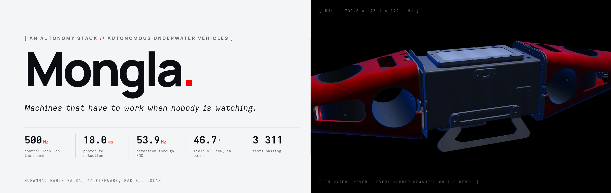
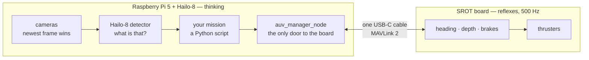
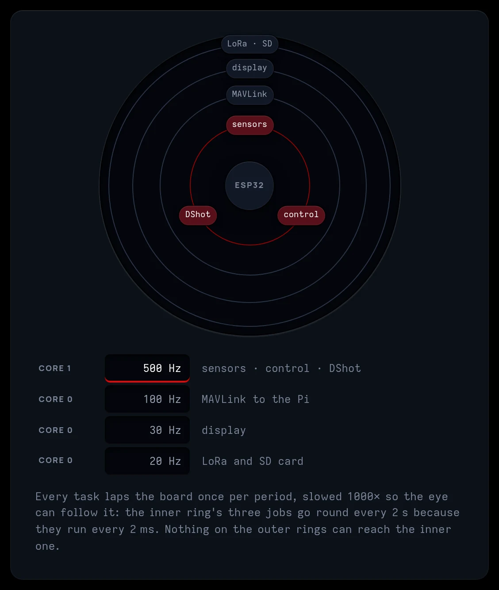
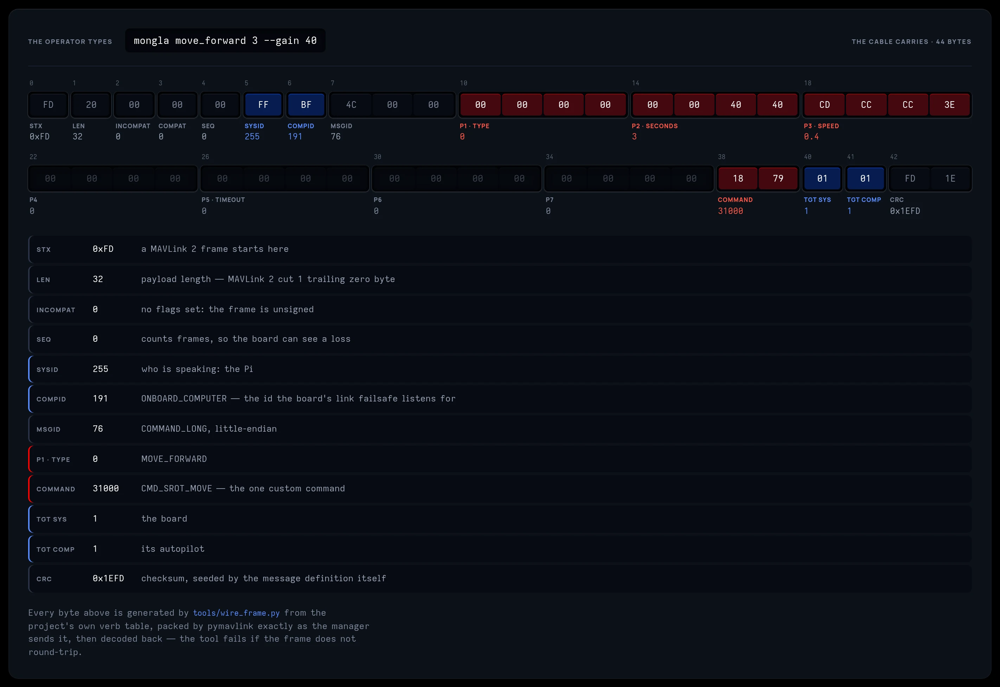
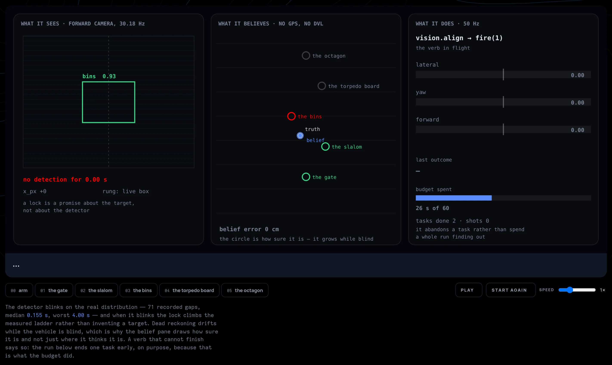
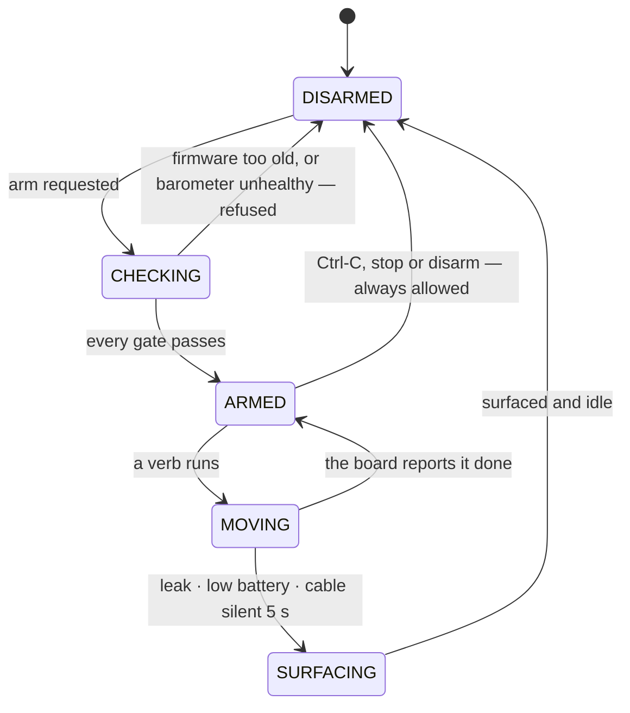
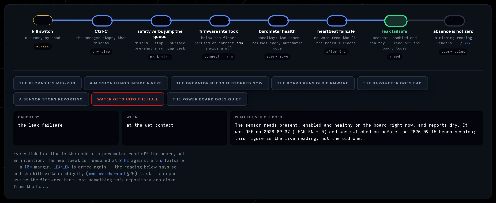
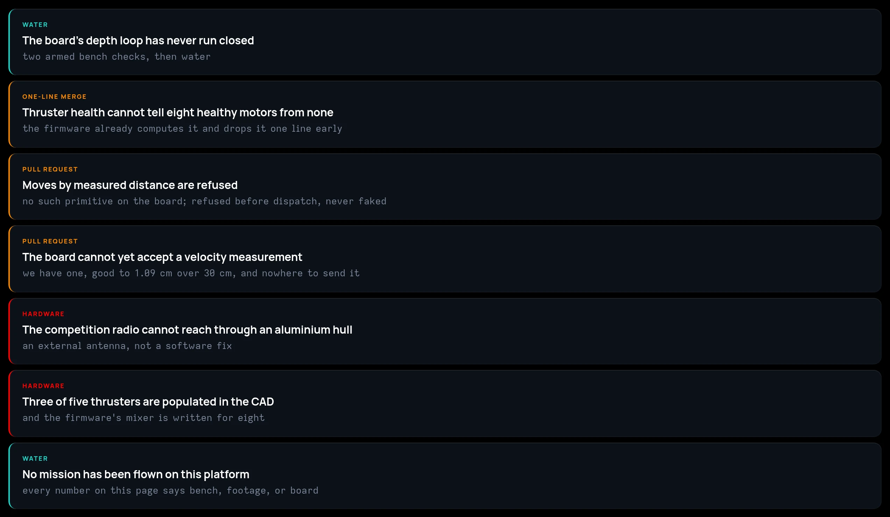
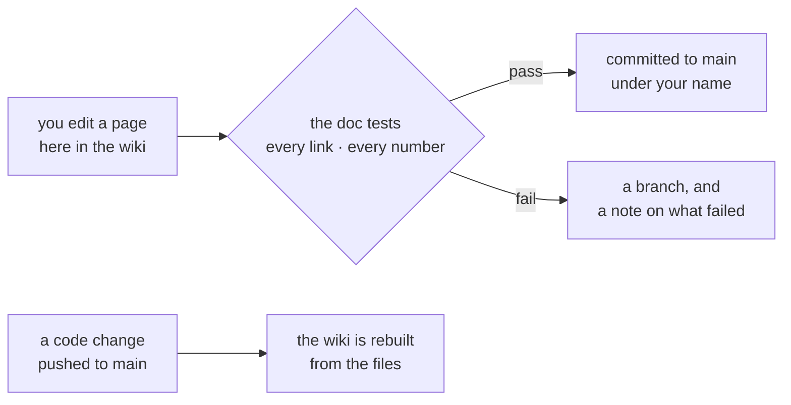

# Mongla



**Mongla is the brain of a small underwater robot.** It sees with a neural network on a chip
that does nothing else, decides what to do in a few lines of Python, and asks a control board
we wrote the firmware for to do it, five hundred times a second. This wiki explains how all of
that works and how to drive it. It also says how much of it is proven, because most of it is
not proven yet.

> **The current platform has never been in water: this stack, on the SROT board and Kutum, in
> the Mongla hull.** Its predecessors competed at RoboSub 2025 and 2026 on another vehicle; what
> ran there and the evidence is in the water lineage (`docs/evidence/lineage.md`), and none of it
> carries over to code that has changed since. Everything here was measured on a bench, on
> real footage from past competitions, or on the live board over a cable. Where a page says
> something works, it says *where* it worked. That habit is the most useful thing in this
> project, and the rest of this page explains why.

---

## The idea, in one picture

A robot that swims has two kinds of work, and they need different machines.

**Reflexes** are things like holding a heading, holding a depth, or catching a thruster that
has stalled. They must happen every 2 milliseconds, every time, and they cannot wait for a
computer that is busy thinking. They live on the **SROT board**, on a core that does nothing
else.

**Thinking** is things like *is that the gate?*, *how far have I come?* and *what next?* It
needs a camera, a neural network and time. It lives on a **Raspberry Pi 5 with a Hailo-8**.



The cable between them is the whole design. Everything on the left can crash and the right
still brakes. Only one program on the left is allowed to touch the cable at all, so a bug in a
mission cannot write a thruster command. [The Shift](../../../docs/the-shift.md) tells this
story from first principles and assumes no background in robotics.



---

## What is true, and how true

Every claim in this project carries a label, and no page mixes them up:

| label | what it means |
|---|---|
| **BENCH** | seen working on the bench, on recorded footage, or on the live board |
| **BUILT** | written and tested, but never run on a swimming vehicle |
| **BLOCKED** | waiting on water, a firmware change or new hardware |
| **WATER** | proven with the vehicle swimming. **Nothing has this label yet.** |

The [Capability Map](../../../docs/capability-map.md) puts a label and a piece of evidence
beside every capability. The [ledger of measurements](../measured-bars.md) holds every
threshold the code ships with, along with how it was measured, including the results we later
took back. A test compares the code's constants with the ledger, in both directions.

---

## Pick a door

| you are… | start with | then |
|---|---|---|
| **driving it** (pool day, the deck, a laptop and a cable) | [Pool day](../platform/pool-day.md) | [Every launch switch](../platform/launch-combinations.md) · [Recording a run](../platform/foxglove-and-bags.md) |
| **writing a mission** | [The mission cookbook](../missions/mission-cookbook.md) | [The vision verbs](../missions/command-reference.md) · [The client and the DSL](../missions/client-and-dsl-api.md) |
| **changing the code** | [The six packages](../packages/README.md) | [How the docs stay true](../reference/how-the-docs-stay-true.md) · [Every known defect](../BUGS.md) |
| **working on the firmware side** | [How the host drives the board](../platform/srot-integration.md) | [The cross-repo contract](../platform/cross-repo-contract.md) · [What we have asked for](../upstream/README.md) |
| **just curious** | [The Shift](../../../docs/the-shift.md) | [What owning the whole chain buys](../the-whole-chain.md) · [the site](https://fh1m.github.io/mongla_ws/), where the explainers let you turn the knobs |

---

## Drive it

Most of Mongla runs without the vehicle: the vision pipeline replays real footage, and the
missions run against the real mission language in the tests. Only the verbs need the board.

```bash
./build_mongla.sh && source install/setup.bash

ros2 run mongla_manager connect --watch        # everything the board says; no ROS graph needed
ros2 run mongla_manager bringup_check   # grades every subsystem; exits non-zero on a fault

ros2 launch mongla_manager bringup.launch.py vision:=true
ros2 run mongla_planner mongla arm
ros2 run mongla_planner mongla move_forward --duration 3 --gain 40
ros2 run mongla_planner mongla --help          # every verb, generated from one table
```

`connect` **looks**. `bringup_check` **decides**, and it is the one allowed to say no. If the
barometer is unhealthy, for example, the board will arm and then refuse to move, and this is
where you find that out instead of in the pool. Every verb, field and default is listed in
[the command reference](../reference/commands.md), which is generated from the code, so it
cannot go stale.

### Configure it: one file

```yaml
# ~/.mongla/bringup.yaml — every setting on the vehicle, in one place
vision: true                 # top level: the capability switches
nodes:                       # under nodes: any node parameter, by node name
  mongla_manager:
    vision.kp_yaw: 80.0
launch:                      # under launch: each other launch file, by name
  video:
    fwd_video: /footage/gate.mp4
```

Every capability is a switch with a default we can defend. The expensive or unproven ones
(`vision`, `flow`, `retrodict`, the uplinks to the board) start **off**; the cheap ones the
filter leans on (`localization`, `lock`, `zupt`, `demand_aid`) start on. Bring the vehicle up
with the defaults, switch one thing on, and measure what it costs. Every default is listed in
[the command reference](../reference/commands.md). If you misspell a key, the launch stops and names the closest real one. ROS on
its own would ignore the typo and run on the default, without a word.

### Tell it what to do

A mission is a Python script, not a state machine you have to draw:

```python
res = mongla.vision.align('gate', lat=0, yaw=0, hold=2.0)
if not res.saw_target:       # never read x_px first: an absent value is NaN, not 0
    return search(mongla)
mongla.move_forward(duration=4, gain=40)
```

The vision verbs never raise an exception. They come back saying *how* they finished
(`ALIGNED`, `LOST`, `TIMEOUT`, `NO_CAMERA`, `ABORTED`, `DRIFTED`, `FAILED`, and for a
gate pass-through `ESTIMATED_CROSSING` or `COMMIT_UNVERIFIED`), so a mission
branches on what happened, not on a crash.

---

## What one command becomes

`mongla move_forward 3 --gain 40` leaves the Pi as one MAVLink 2 frame, 44 bytes long:



And this is what a run looks like from the inside: what it sees, what it believes, and what
it is doing, all on one clock.



---

## What keeps it from hurting someone

A thruster can take a finger off, so safety comes before everything else on this page. These
are the states the vehicle can be in, and the paths that always lead back to safe:



The board surfaces by itself, with or without the Pi. On top of that there is a chain of
checks, and each kind of failure is caught by one link in it, starting with a human on the
kill switch. The rules behind it are written out in
[the README](../../../README.md#what-keeps-it-from-hurting-someone).



The rule at the end of the chain causes the most trouble in practice: **a missing number is
shown as `--`, never as `0.0`.** A depth of zero and an unknown depth mean very different
things for a robot underwater.

---

## What stands in the way



None of the blockers can be cleared from this repository alone. The [Roadmap](../ROADMAP.md)
says where things stand. [What water has to decide](../platform/first-pool-verification.md)
lists, in order, what the first pool session must prove.

---

## How this wiki works

This wiki is the place to read and edit the docs. Each page is also a file in
[the repository](https://github.com/fh1m/mongla_ws), because the tests that keep the docs
honest run on files:



So a link to a page that does not exist, or a number the code no longer uses, cannot quietly
land. [How the docs stay true](../reference/how-the-docs-stay-true.md) explains the machinery.

**[Read the whole book →](../README.md)** It has every chapter in reading order, from why
the vehicle is built this way to every defect we have found. The sidebar holds the same book,
one part at a time.
