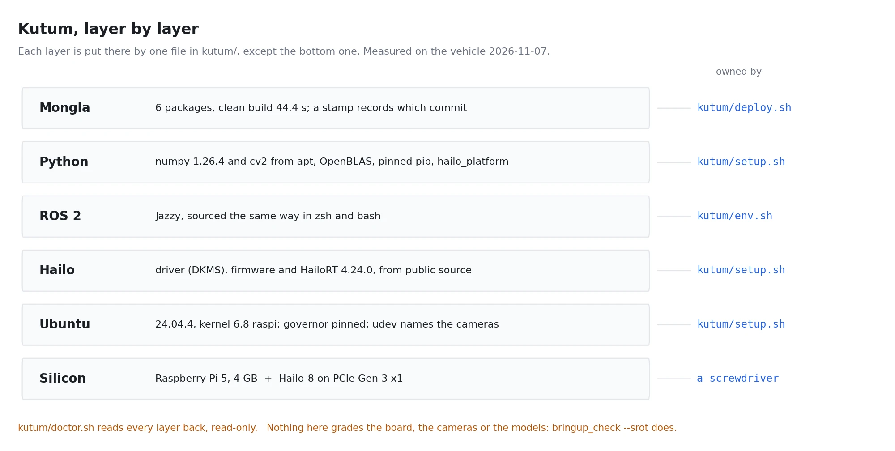

# kutum/

Kutum is the vehicle's compute module: a Raspberry Pi 5 with a Hailo-8 AI HAT+, Ubuntu
24.04 and ROS 2 Jazzy. This folder is that machine, as files. Why it exists, what is on it
and how it is laid out:
[the Kutum chapter](../.claude/context/kutum/README.md).



## The files

```
kutum/
  setup.sh            make a Pi into Kutum            (--system: the machine; plain: your account)
  deploy.sh           put this tree on it, build, gate   (run from the dev box)
  doctor.sh           is it still Kutum?                 (read-only, exits 1 on FAIL)
  backup.sh           pull what only the vehicle has     (run from the dev box)
  env.sh              what every terminal on the vehicle sources
  requirements.txt    the pip packages, pinned to what runs on the vehicle
  constraints.txt     numpy < 2, applied to every pip install
  system/
    udev/99-mongla-cameras.rules   stable camera names by USB port
    udev/51-hailo-udev.rules       /dev/hailo0 readable without root
    udev/make_srot_rule.sh         pin the SROT board to /dev/srot (once per board)
    systemd/cpu-performance.service + set-cpu-performance   CPU governor at boot
    netplan/60-kutum-eth.yaml      Ethernet: DHCP plus a link-local fallback
```

## The network

Kutum answers as **`mongla.local`** on every interface (avahi), so the address
never matters:

| Link | How it gets an address |
|---|---|
| Ethernet to a router | DHCP |
| Ethernet straight to a laptop sharing its internet | DHCP from the laptop. On a NetworkManager laptop: `nmcli connection modify "<wired connection>" ipv4.method shared`, then reconnect |
| Ethernet straight to a laptop, no sharing | a link-local address (169.254.x.x); `mongla.local` still resolves |
| Wi-Fi | joins the network `setup.sh --system` asked for, on every boot when it is in range |

The Wi-Fi password is typed into `setup.sh --system` by whoever runs it and
lives only in `/etc/netplan/61-kutum-wifi.yaml` (root, mode 0600). To change
networks: `sudo rm /etc/netplan/61-kutum-wifi.yaml`, then rerun
`sudo ~/mongla_ws/kutum/setup.sh --system`.

## The clock

The Pi 5 has a real-time clock; the official RTC battery keeps it running
through a power-off, so a vehicle booted at a pool with no network still knows
the date. `setup.sh --system` turns on the battery's trickle charge
(`dtparam=rtc_bbat_vchg=3000000` in `/boot/firmware/config.txt`; rechargeable
ML-2020 cells only). The doctor reads the charge voltage and whether network
time has synchronised since boot.

## Every day

```bash
kutum/deploy.sh fh1m@mongla.local               # after any change: sync, doctor, build, gate
kutum/deploy.sh fh1m@mongla.local --check-only  # the doctor, nothing changed
kutum/backup.sh fh1m@mongla.local               # after anything is made on the vehicle
kutum/backup.sh fh1m@mongla.local --runs        # ... and the runs and footage (gigabytes)
ssh fh1m@mongla.local bash -s < kutum/doctor.sh # the doctor, from here
```

On the vehicle, every shell already has ROS and the workspace (`env.sh`), so:

```bash
~/mongla_ws/kutum/doctor.sh
ros2 run mongla_manager bringup_check --srot
```

**Caution:** `deploy.sh` does a clean build, which deletes `install/`. It refuses while a
`mongla_manager` is running on the vehicle: stop it with Ctrl-C, so it disarms, and rerun.

The doctor's three words: `ok` as declared, `WARNING` runs but worse than declared,
`FAIL` the stack cannot run here. Deploy stops on a FAIL and builds through a WARNING.

## When Kutum burns

The repo rebuilds everything except what was made on the vehicle, and `backup.sh` keeps
that. From a blank SD card to a gated vehicle:

1. **Flash** Ubuntu Server 24.04 LTS (64-bit) for the Raspberry Pi with Raspberry Pi
   Imager. In its settings: hostname `mongla`, user `fh1m`, your SSH public key.
2. **Seat the AI HAT+** and its PCIe ribbon. Boot on Ethernet, then
   `ssh fh1m@mongla.local`.
3. **Install ROS 2 Jazzy** `ros-base`, following the official
   [Ubuntu (deb packages) instructions](https://docs.ros.org/en/jazzy/Installation/Ubuntu-Install-Debs.html).
4. From the dev box: `kutum/deploy.sh fh1m@mongla.local`. It syncs the tree, then the
   doctor stops it, because there is no Hailo stack yet. That stop is expected.
5. On the vehicle: `sudo ~/mongla_ws/kutum/setup.sh --system`. This builds the Hailo
   driver, firmware and runtime from source (the runtime build is the long part), installs
   `system/`, gives `fh1m` passwordless sudo, runs the user half, and ends with the doctor.
   Log out and back in, so the `dialout` group applies.
6. From the dev box, put back what only the old vehicle had:
   `rsync -a --exclude .backed-up ~/kutum-backup/mongla/ fh1m@mongla.local:~/`
7. From the dev box: `kutum/deploy.sh fh1m@mongla.local`. The detector models travel with
   the tree (they are untracked files in `src/mongla_vision/models/`, so they come from
   the dev box's copy). It builds and runs `bringup_check --srot`.
8. **Plug in the board** and pin it once:
   `~/mongla_ws/kutum/system/udev/make_srot_rule.sh`.

**State:** steps 4, 6 and 7 RUN TODAY. Step 5 is the hand-built procedure of 2026-08-28
written as one script, and has not yet run on a blank card. When it does, note what broke
here.

## Security, on purpose

`setup.sh --system` writes `/etc/sudoers.d/90-kutum-fh1m` with `NOPASSWD: ALL`. Kutum is
a single-purpose machine on the vehicle's own network, and a password prompt in the middle
of a pool session costs more than it protects (the owner's call, 2026-11-07). Delete that
file to undo it. `deploy.sh` and `backup.sh` run ssh in `BatchMode`: they need a key
(`ssh-copy-id fh1m@mongla.local`, once) and never prompt for a password.
